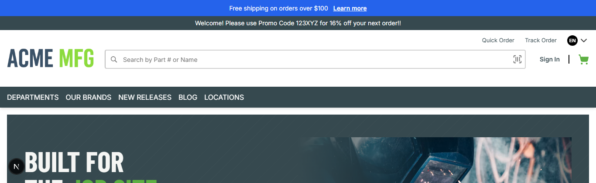

# 008: Can I install or update a package without a build or restart?

**Listed:** Yes. **Result here:** Yes, confirmed.

| Before | After |
| --- | --- |
|  |  |

## What changed

The announcement bar gets a **Learn more** link to the theme's welcome page (`/spp-customization-welcome`). The
update went live by running `npm run deploy` and refreshing the page: no webstore build, no restart. The webstore
process listening on port 3000 is the same before and after (pid 21432, started 12:17:11).

## Where

- `src/slots/AnnouncementBar.tsx`: the text in a ``, plus a `next/link` to `/spp-customization-welcome`
  (`data-test-selector="linkAnnouncement"`)
- `src/styles/theme.css`: the bar is a centered flex row; `.spp-customization-announcement__link` (white, bold,
  underlined)

## How

1. `npm run deploy`: builds, packs and installs into the store's plugin folder (about 4 s). The store re-reads
   `plugins.json` when it changes and loads the new files.
2. Refresh the page.

`output.txt` / screenshots: the webstore process id and start time before and after the deploy (unchanged), the
deploy output, and the page before and after (`node scripts/shot.mjs --path / --height 420`).
