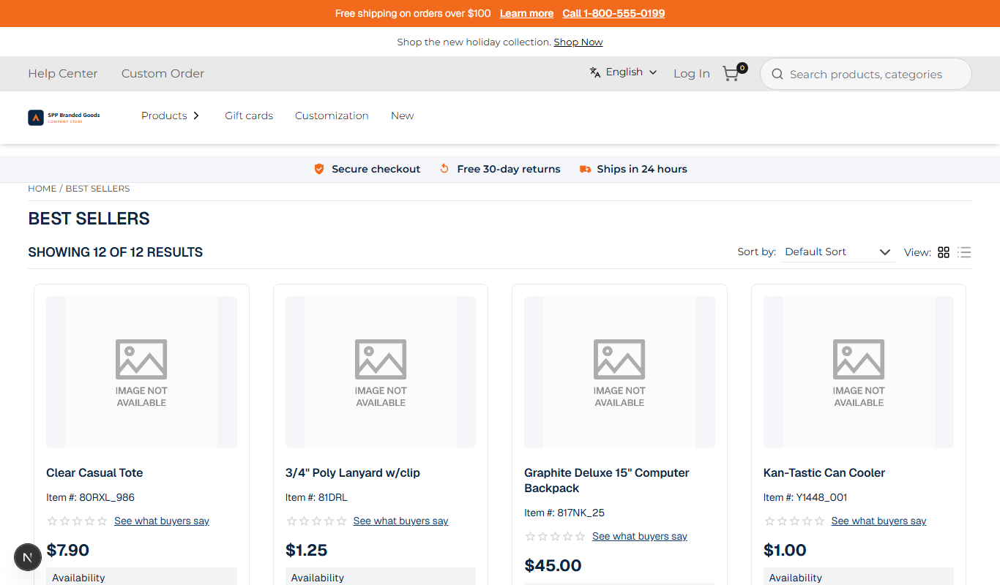
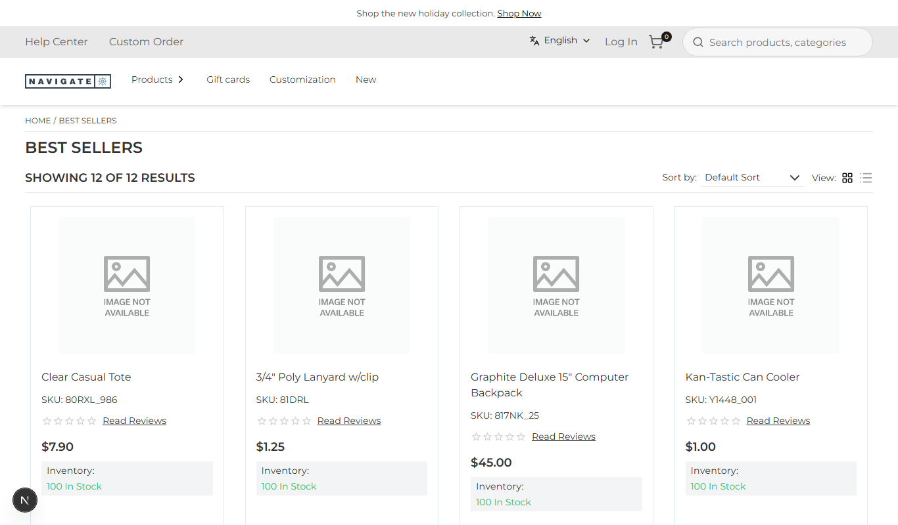

# 012: Can a package be switched on or off without uninstalling it?

**Listed:** Yes. **Result here:** Yes, confirmed.

| On | Off | On again |
| --- | --- | --- |
|  |  |  |

Store: POCSppDemo (`sppdemo.localhost:3000`), category Best Sellers, no preview cookie (what shoppers see).

## The example: a kill switch with a fallback theme

A new theme goes live with the previous one kept behind it, so it can be paused instantly (an incident, a campaign
that ended) and the store falls back to the theme it had:

1. **Priority**: spp-customization's entry is moved just before redpanda in `plugins.json`, and POCSppDemo is placed
   on both. The store takes the first theme that is on: spp-customization.
2. **Off** (`"enabled": false`): the store falls back to redpanda (Navigate logo, "SKU", "Read Reviews", no trust
   strip). The package stays installed: its 8 files are still in the plugin folder, its settings and stores are kept.
3. **On** again: spp-customization is back, as it was.

No deploy, no restart; a page refresh shows each state.

```
$ node scripts/registry.mjs themes POCSppDemo
1. spp-customization (parent redpanda): on
2. redpanda (parent spp-base): on
$ node scripts/registry.mjs enable false     ->  1. spp-customization: off   2. redpanda: on
$ node scripts/registry.mjs enable true      ->  1. spp-customization: on    2. redpanda: on
```

## Where

- `scripts/registry.mjs`: new `before <package>` command (move this entry just before another: priority)
- `<plugin folder>/plugins.json`: entry order (spp-customization before redpanda), redpanda `"stores": ["POCSppDemo"]`,
  spp-customization `"enabled"` false then true. No code change.

## How a client does this

Set the package's `"enabled"` to `false` in `plugins.json` (or `node scripts/registry.mjs enable false`); `true` to
switch it back on. To have a fallback, keep the previous theme placed for the store, after this one.
