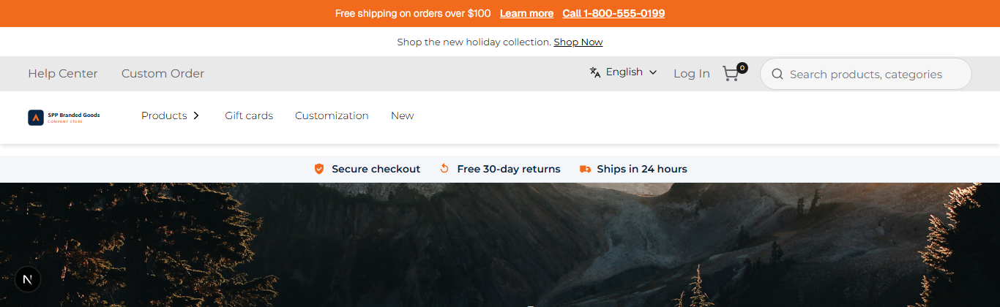
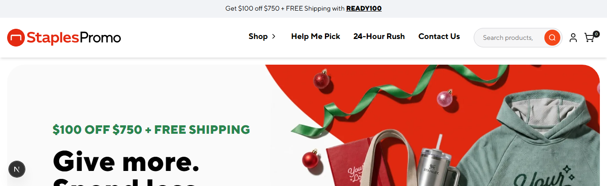

# 013: Can a package be installed for some stores only?

**Listed:** Yes. **Result here:** Yes, confirmed.

| POCSppDemo: theme placed | POCStaplesPromo: not placed |
| --- | --- |
|  |  |

Both from the same webstore and the same plugin folder, at the same moment, without a preview cookie.

## The example: a pilot rollout on one store

A new theme is usually piloted on one store before the others. spp-customization is installed once, in the shared
plugin folder, and placed for one store: `"stores": ["POCSppDemo"]`.

| Host | Store | Runs spp-customization |
| --- | --- | --- |
| `sppdemo.localhost:3000` | POCSppDemo | **yes**: announcement bar, co-brand logo, trust strip |
| `staplespromo.localhost:3000` | POCStaplesPromo | no: its own theme and header |
| `nvidia.localhost:3000` | POCNvidia | no |
| `lol.localhost:3000` | POCLandOLakes | no |

(`/api/extensions` on each host, in `output.txt`.)

## How it renders

**In the webstore (base):** as 012 ([§2 A](../../RENDER-FLOW.md#2-which-store-which-packages-every-request))

**How this customization joins it:** only stores listed in the entry's `"stores"` get the package from `resolveStoreEntries` ([§2 B.2](../../RENDER-FLOW.md#2-which-store-which-packages-every-request))

End-to-end flow, with file and line references in the webstore: [docs/RENDER-FLOW.md](../../RENDER-FLOW.md).

## Where

No change in this step: the placement from 034 (`"stores": ["POCSppDemo"]` in `plugins.json`). To widen the pilot,
add store codes to the list (157); `"*"` or no list places it for every store.

## How a client does this

List the store codes in the package's `"stores"`; stores not listed never load its code, CSS or settings.
