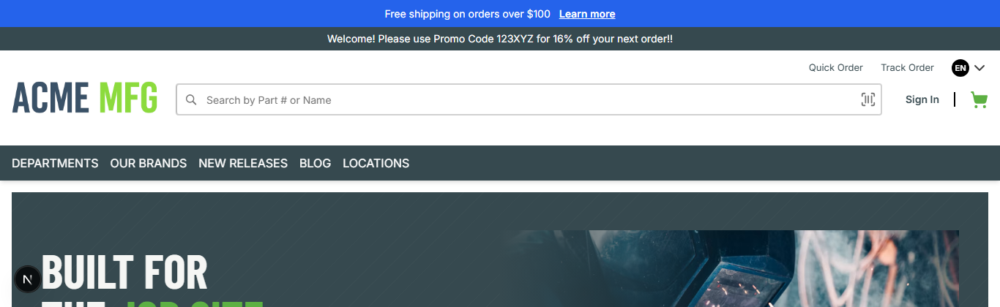
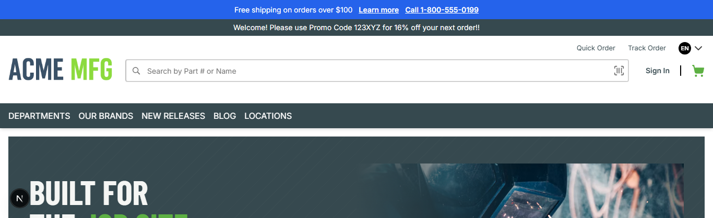

# 015: Can a package declare required settings?

**Listed:** Yes. **Result here:** Yes, confirmed.

| Before | Required setting still empty | After (value set) |
| --- | --- | --- |
|  |  |  |

## What changed

A new **required** setting, `supportPhone` (the customer service phone). When it has a value, the announcement bar
shows a **Call 1-800-555-0199** link (`tel:`). While it is empty the bar just leaves it out, so the page never breaks.

The install reports a required setting that is still empty (016). The store itself does not enforce `required`; it is
for the install report and for whoever configures the package (an admin screen does not exist yet, row 19).

## How it renders

**In the webstore (base):** the layout JSON's header item → agent `getHeaderInitialDetails` (portal logo, mega-menu categories) → `HeaderRender` → `Header` (`<header id="webstore-header">`) ([§8 A](../../RENDER-FLOW.md#8-header-footer-search))

**How this customization joins it:** the setting's value comes from the registry entry (or a store attribute) → `getBrowserManifest` passes only `"browser": true` settings to the browser part → `AnnouncementBar` reads `settings.supportPhone` ([§2 B.3](../../RENDER-FLOW.md#2-which-store-which-packages-every-request), [§3 B.2](../../RENDER-FLOW.md#3-the-page-shell-root-layout-head-styles-labels-server-layout)); `HeaderRender` → `RuntimeHeader` → `<RuntimeSlot name="layout.header">`: the theme's `AnnouncementBar` slot gets the store's header as `children` and renders its bars around it ([§8 B](../../RENDER-FLOW.md#8-header-footer-search))

End-to-end flow, with file and line references in the webstore: [docs/RENDER-FLOW.md](../../RENDER-FLOW.md).

## Where

- `znode-package.json` → `settingsSchema.supportPhone`: `"type": "string"`, `"required": true`, `"browser": true`,
  no default (a required setting with a default gets a `znode check` warning)
- `src/slots/AnnouncementBar.tsx`: reads `settings.supportPhone`, renders the `tel:` link
  (`data-test-selector="linkSupportPhone"`)
- `scripts/registry.mjs` (new): changes this package's entry in the store's `plugins.json` with the same lock and
  `.history/` copy as `znode install`; used here to set the value

## How

```bash
npm run check      # 0 errors, 0 warnings
npm run deploy     # ... settings to fill in before enabling: supportPhone
node scripts/registry.mjs set supportPhone=1-800-555-0199
```
