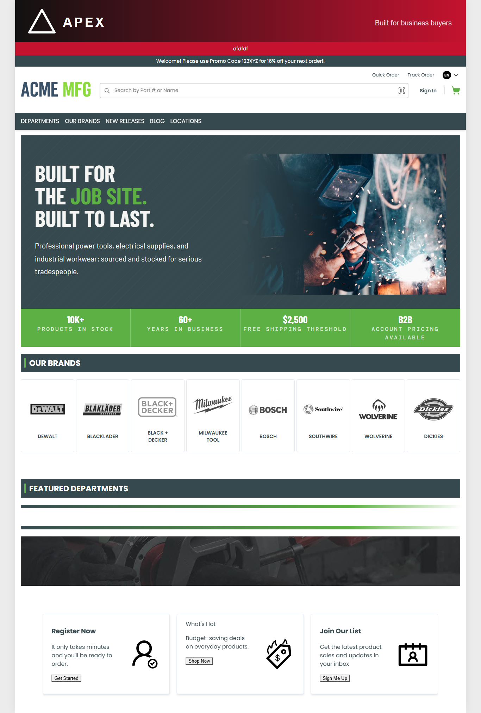
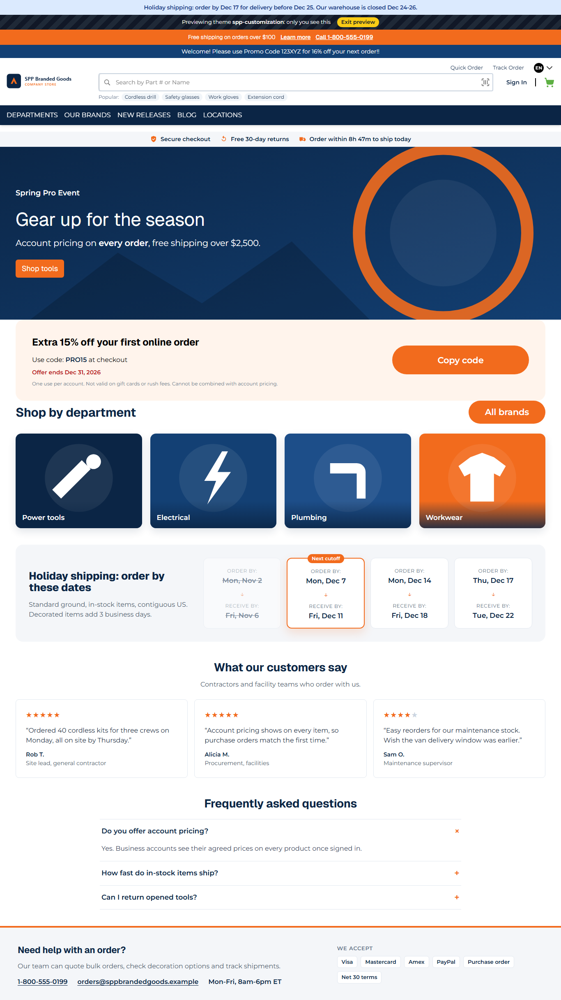
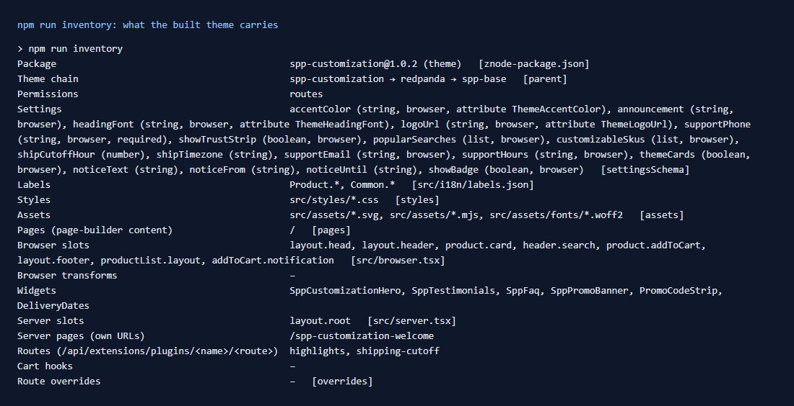

# 023: Can I create a complex theme?

**Listed:** Yes. **Result here:** Yes, confirmed. `spp-customization` is one theme package that carries design
tokens, its own font, CSS for every page type, labels, assets, settings bound to store attributes, eight browser slots,
a server layout slot, six page-builder widgets, a home page, an own URL and two API routes, on top of a two-level parent
chain (`redpanda` → `spp-base`). Rows 24-41 are its parts; all are done except 40 (a theme cannot take over a store API
route: a plugin does it, row 98).

| Before: the Acme store's home (theme `apex`) | After: the same store with spp-customization previewed |
| --- | --- |
|  |  |

Store: MaxwellsHardware (`localhost:3000`), home page, full page; after with `?theme=spp-customization` preview.

## The example: an inventory of the theme, from its build

A theme this size needs a way to see what it actually ships, so this row adds **`npm run inventory`**
(`scripts/inventory.mjs`). It reads the manifest and imports the **built** browser and server parts (the files the
store loads, not the sources) and lists every extension point they fill. Any package works:
`npm run inventory -- spp-commerce.znode-package.json`.

Full output: [output.txt](output.txt).

## What the theme is made of (rows 24-41)

| Row | Part | Where in this repo |
| --- | --- | --- |
| 24 | CSS-only design tokens | `src/styles/tokens.css` |
| 26, 27 | Child theme, two levels of parents | `"parent": "redpanda"` in `znode-package.json` |
| 28 | Own font file | `src/assets/fonts/*.woff2`, `src/styles/fonts.css` |
| 29, 31 | CSS updates that do not clash with the store's CSS | `src/styles/listing.css`, `dedupeStyles`, `spp-` class prefix |
| 30, 33 | Accent color, heading font and logo per store (store attributes) | `settingsSchema` (`attribute`), `src/server/ThemeLayout.tsx` |
| 32 | Labels | `src/i18n/labels.json` |
| 34-36 | Assigned per store, switched without a deploy, previewed first | `scripts/registry.mjs`, preview cookie |
| 37, 38 | Page-builder preview and widgets | `src/widgets/*`, `src/styles/editor.css` |
| 39 | Routes | `src/server.tsx` (`highlights`, `shipping-cutoff`) |
| 41 | Mobile layout | `src/styles/mobile.css` |
| 48-55 | Header, footer, card, popup, layouts (row 25) | `src/slots/*`, `src/server/ThemeLayout.tsx` |

## How it renders

**In the webstore (base):** the store resolves its theme (`resolveStoreEntries`), renders the root layout, header,
page-builder content and footer of the base components ([§1-§4 A](../../RENDER-FLOW.md#1-from-this-repository-to-the-store-install-registry)).

**How this customization joins it:** the resolved chain is root first (`spp-base` → `redpanda` → `spp-customization`);
each package's CSS is linked in that order, its server slot wraps the layout, its browser slots reduce over the
parents' output and its widgets are added to the page-builder config ([§2 B.2](../../RENDER-FLOW.md#2-which-store-which-packages-every-request), [§3 B.1](../../RENDER-FLOW.md#3-the-page-shell-root-layout-head-styles-labels-server-layout),
[§8 B](../../RENDER-FLOW.md#8-header-footer-search), [§9 B](../../RENDER-FLOW.md#9-home-content-and-package-pages-widgets)).

End-to-end flow, with file and line references in the webstore: [docs/RENDER-FLOW.md](../../RENDER-FLOW.md).

## Where

- `scripts/inventory.mjs` (new), `package.json` script `inventory`

## How a client does this

Build the theme up in parts (tokens, then CSS, then slots and widgets), each in its own folder under `src/`, and check
what the built package carries with `npm run inventory` before deploying.
