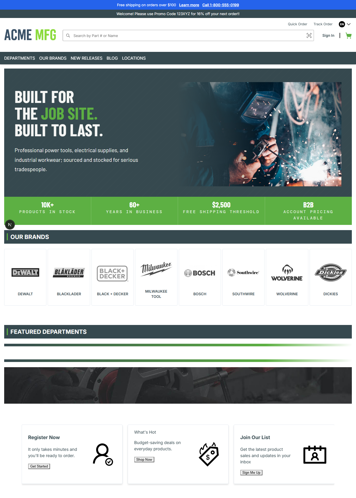

# 024: Can I create a theme with CSS only (tokens, fonts, colors)?

**Listed:** Yes. **Result here:** Yes, confirmed.

| Before | After |
| --- | --- |
|  |  |

## What changed

A design-token stylesheet sets the store's own CSS variables to an SPP palette (navy `rgb(11, 37, 69)`, orange
`rgb(242, 107, 29)`). No component code changes: the store's base components read these variables. Visible in the
screenshots:

- promo ticker: `--ticker-bg` → SPP blue
- navigation bar: `--navigation-bar-bg` / `--navigation-text` → navy with white text
- headings and brand text: `--primary` → navy
- buttons, links, cards, inputs, footer and keyboard focus: `--primary-btn-*`, `--link`, `--hover`, `--card-*`,
  `--input-*`, `--footer-*`, `--focus-outline-*`

Page-builder content keeps the colors its editor saved (the hero, the green stats strip, the brand headers).

## Where

- `src/styles/tokens.css` (new): `html[data-theme] { --primary: ...; ... }`. The `html[data-theme]` selector outranks
  the built-in `:root` tokens and the portal's inline theme CSS whatever the load order. The token names are the base
  components' (`packages/base-components/src/tailwind-config/global.css` in the store repo).
- Picked up by `"styles": ["src/styles/*.css"]` in `znode-package.json`; no manifest change.

## How

`npm run deploy`, then the page with the theme previewed (`node scripts/shot.mjs --path / --full`).
