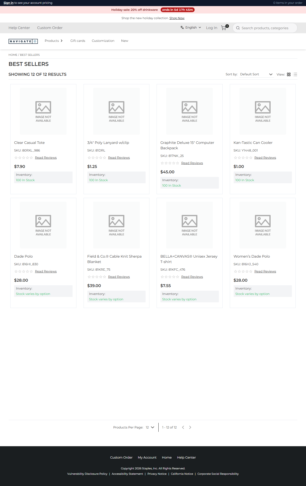
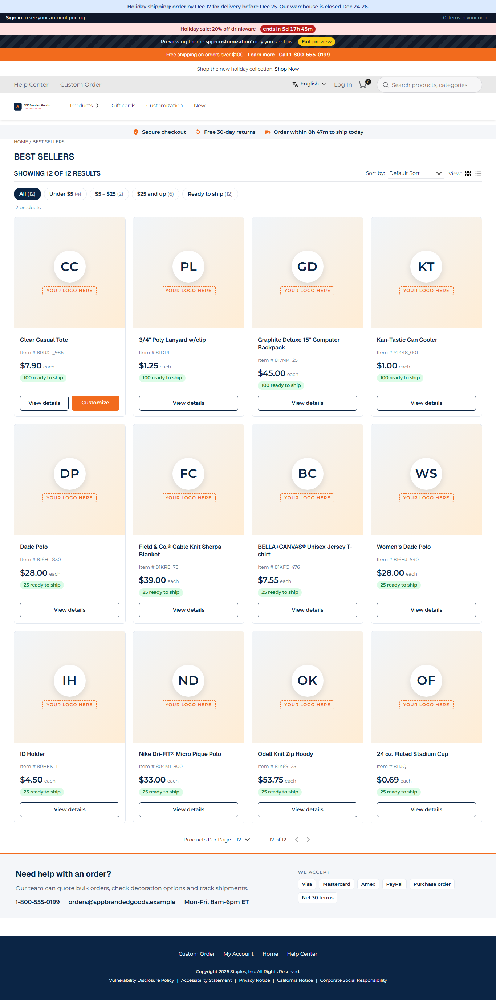

# 025: Can a theme carry UI code (header, footer, cards, layouts)?

**Listed:** Yes. **Result here:** Yes, confirmed: the theme's React components replace or wrap the header, footer,
product card, listing layout, product-page parts and the added-to-cart popup, and its server component wraps the root
layout. One listing page shows most of them at once.

| Before: Best Sellers with the store's own theme (redpanda) | After: the same page with spp-customization's UI code |
| --- | --- |
|  |  |

Store: POCSppDemo (`sppdemo.localhost:3000`), Best Sellers (`/category/1674`), full page; after with the theme
previewed.

## The example: a promotional-products storefront, top to bottom

What the "after" picture shows, and the component behind each part:

| Part of the page | Slot | Component | Row |
| --- | --- | --- | --- |
| Dated holiday notice, skip link, accent color, logo | `layout.root` (server) | `src/server/ThemeLayout.tsx` | 52, 53 |
| Announcement bar, preview banner, trust strip with the shipping cut-off countdown | `layout.header` | `src/slots/AnnouncementBar.tsx`, `TrustStrip.tsx` | 48 |
| Popular searches under the search box | `header.search` | `src/slots/SearchWithPopular.tsx` | 48 |
| Quick price filters and the theme's own card grid | `productList.layout` | `src/slots/ProductListing.tsx` | 54 |
| "Your logo here" card, Item #, price each, stock pill, Customize | `product.card` / the listing's `ProductCard` | `src/slots/ProductBadge.tsx`, `ProductListing.tsx` | 50 |
| "Need help with an order?" and payment methods above the footer | `layout.footer` | `src/slots/FooterHelp.tsx` | 49 |
| Customize & order, product facts (product page) | `product.addToCart` | `src/slots/CustomizeToOrder.tsx`, `ProductFacts.tsx` | 55 |
| Added-to-cart popup | `addToCart.notification` | `src/slots/AddedToCart.tsx` | 51 |
| Meta tags and favicon | `layout.head` | `src/slots/HeadTags.tsx` | 53 |

The list of slots the built theme fills, from `npm run inventory` (row 023):

```
Browser slots   layout.head, layout.header, product.card, header.search, product.addToCart, layout.footer,
                productList.layout, addToCart.notification
Server slots    layout.root
```

## How it renders

**In the webstore (base):** each of these places renders a base component through `RuntimeSlot` (browser) or a server
slot, with the base output as `children` ([§4 A](../../RENDER-FLOW.md#4-worked-example-the-product-card-on-a-category-page), [§8 A](../../RENDER-FLOW.md#8-header-footer-search)).

**How this customization joins it:** `RuntimeSlot` reduces over the store's packages in order (parents first): each
gets the previous output as `children` and may wrap it, replace it or return it; the theme comes last, so its output is
what the page shows ([§4 B](../../RENDER-FLOW.md#4-worked-example-the-product-card-on-a-category-page), [§8 B](../../RENDER-FLOW.md#8-header-footer-search)). `layout.root` does the same on the
server.

End-to-end flow, with file and line references in the webstore: [docs/RENDER-FLOW.md](../../RENDER-FLOW.md).

## Where

No new code: this row is the sum of rows 48-55, shown together on one page. See each row's folder for its change.

## How a client does this

Register a component per slot in the theme's `src/browser.tsx` (`slots: { "<slot>": Component }`) and, for the root
layout, in `src/server.tsx` (`serverSlots`). Render `children` to keep the store's part, or leave it out to replace it.
