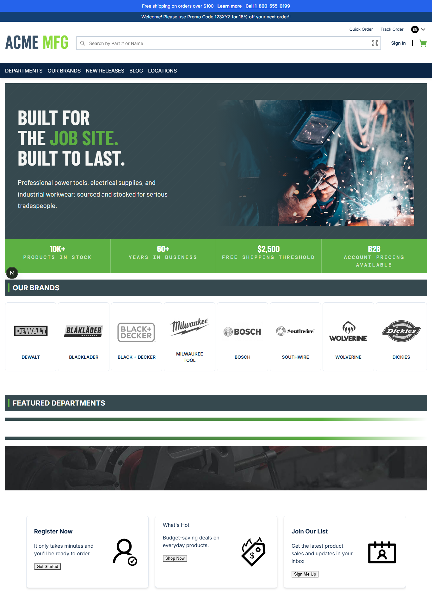
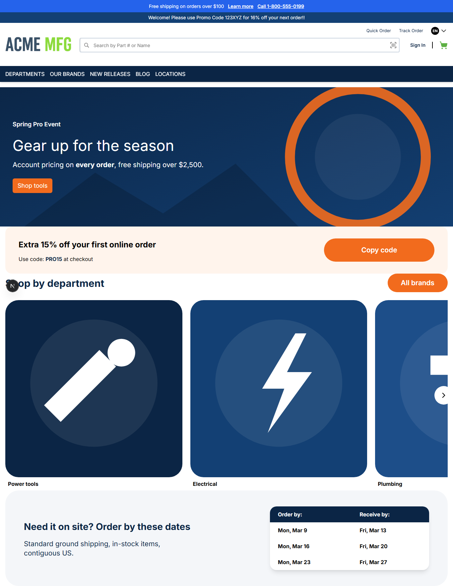

# 026: Can a child theme inherit from a parent theme?

**Listed:** Yes. **Result here:** Yes, confirmed.

| Before (no parent) | After (child of spp-base) |
| --- | --- |
|  |  |

## The example: a campaign home page built from the parent's widgets

A common storefront pattern (a seasonal sale landing page: hero, promo code, shop-by-department tiles, order-by
dates) made **without writing any widget code**. spp-customization becomes a child of `spp-base` and uses the
parent's widgets in its own home page:

| Section | Parent widget (spp-base) | Child's content |
| --- | --- | --- |
| "Spring Pro Event" hero | `HeroBanner` | Campaign image, headline, "Shop tools" → `/tools` |
| "Extra 15% off" strip with **Copy code** | `PromoCodeStrip` | Code `PRO15` |
| "Shop by department" | `CardGrid` | Power tools, Electrical, Plumbing, Workwear → the store's real category URLs |
| "Order by these dates" | `DeliveryDates` | Three order-by / receive-by rows |

The child's own parts still apply on top: its design tokens (024) color the navigation, ticker and buttons, and its
announcement bar stays. On a page the parent renders, the child's CSS loads **after** the parent's
(`spp-base-1.2.1.css`, then `spp-customization-1.0.2.css`), so the child wins where both set something.

## Where

- `znode-package.json`: `"parent": "spp-base"`; `"pages": { "/": "src/pages/home.json" }`
- `src/pages/home.json` (new): page-builder JSON (`content` = the four widgets with their props)
- `src/assets/spp-customization-campaign-hero.svg`, `spp-customization-tile-{tools,electrical,plumbing,workwear}.svg`
  (new): the campaign's own artwork

## How a client does this

1. Set `"parent"` to the theme to build on; its widgets, slots and CSS come along.
2. Use the parent's widget types in pages, by `type` name with the props its editor defines (spp-base:
   `runtime-plugins/theme/spp-base/src/widgets/editor.ts` in the store repo), either in the page builder or, as here,
   in a page file the theme ships.
3. Override what differs: tokens, CSS, or a slot of the same name.

`npm run deploy`, then the home page with the theme previewed.
