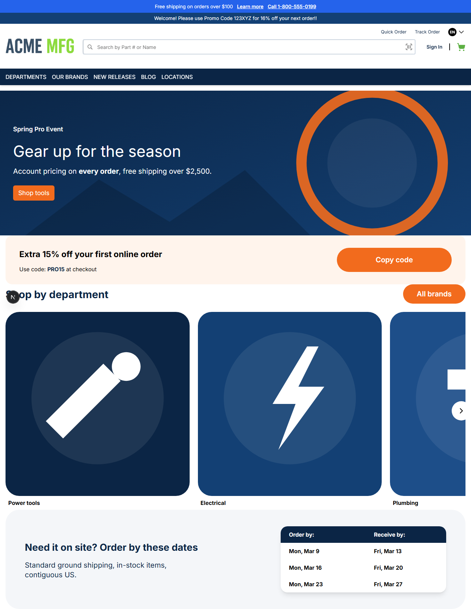
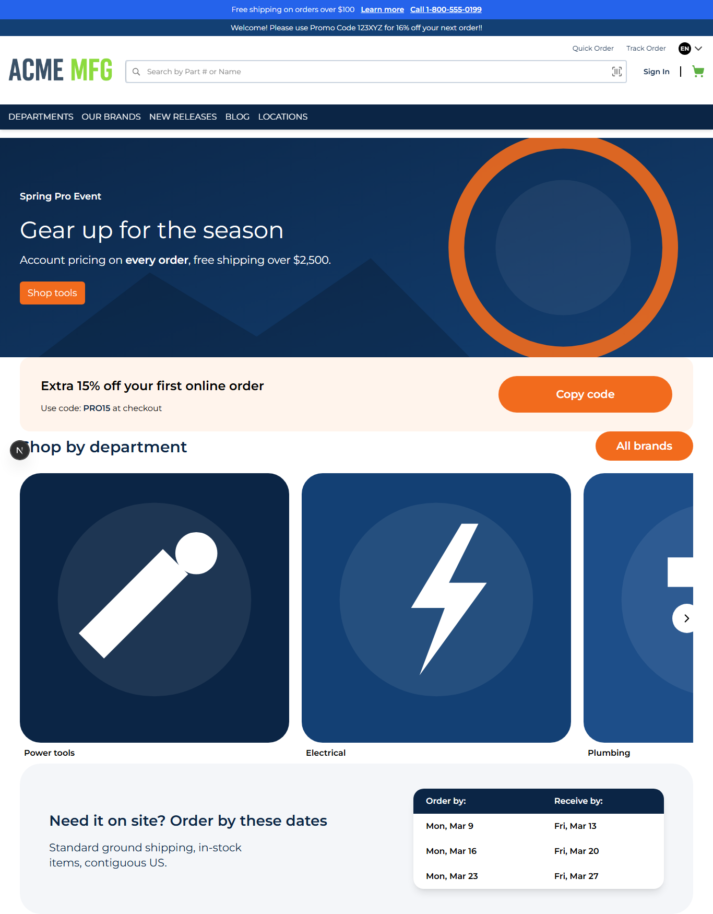

# 027: Can themes inherit more than one level deep?

**Listed:** Yes. **Result here:** Yes, confirmed: three levels (spp-base → redpanda → spp-customization).

| Before (child of spp-base) | After (child of redpanda, grandchild of spp-base) |
| --- | --- |
|  |  |

Closer look at the top of the page: [after-top.png](after-top.png).

## The example: a sub-brand in a brand family

Retail groups often run several stores as one brand family: shared typography and components, a color accent per
store. Here **Red Panda** is the family style (Montserrat, square corners, dark footer) and itself builds on
**spp-base** (widgets, header, listing card). spp-customization becomes a sub-brand of Red Panda:

| Comes from | What the page shows |
| --- | --- |
| spp-base (grandparent) | The home page's HeroBanner, PromoCodeStrip, CardGrid, DeliveryDates widgets |
| redpanda (parent) | **Montserrat** on body and headings (was the theme's own Inter) |
| spp-customization (child) | Its navy/orange tokens and rounded buttons, which override Red Panda's black square ones; its announcement bar |

The stylesheets load in that order, so the nearest theme wins: `spp-base-1.2.1.css`, `redpanda-1.0.0.css`,
`spp-customization-1.0.2.css` (`output.txt`).

## Where

- `znode-package.json`: `"parent": "redpanda"` (was `spp-base`)
- `src/server/ThemeLayout.tsx`: no longer puts its own font class on the page, so the family's typography applies
- `src/server/fonts.ts`: removed (the Inter font is no longer used)

## How a client does this

Point `"parent"` at the theme that is closest to the look you want; everything above it in the chain comes along
(up to 8 levels). Override only what makes your store different.
