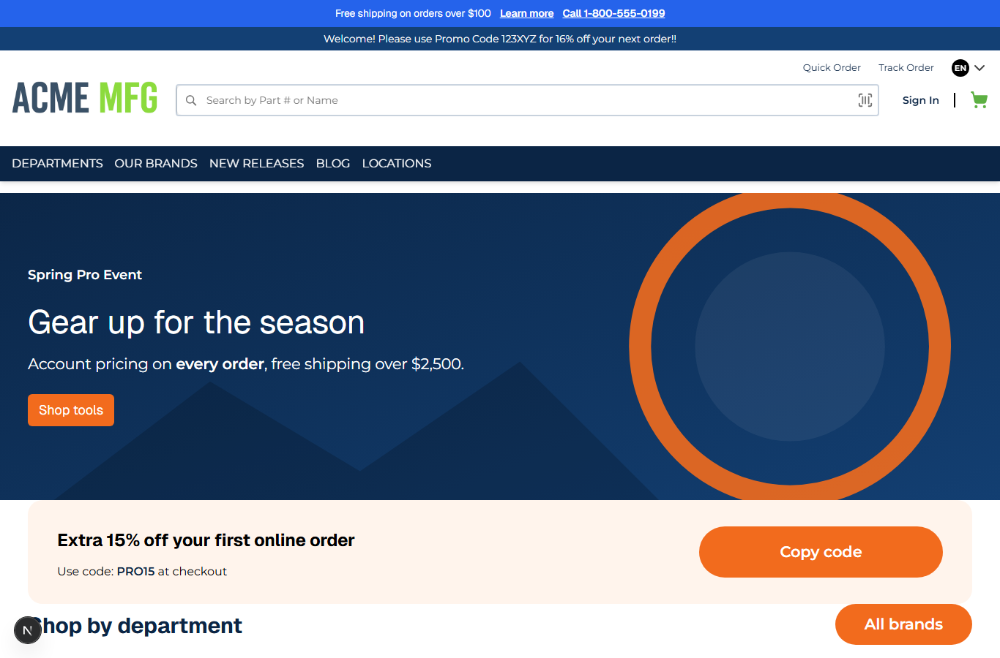

# 028: Can I use my own font files in a theme?

**Listed:** Yes. **Result here:** Yes, confirmed.

| Before | After |
| --- | --- |
|  |  |

## The example: a self-hosted brand font for headings

Brands usually license a display face and host it themselves (no Google Fonts call, no third-party request). The
theme ships its own `.woff2` file and uses it for headings ("Gear up for the season", "Extra 15% off...", "Shop by
department") and the announcement bar, while body text keeps the family font (Montserrat, from redpanda, 027).

The font is **Geist** (SIL Open Font License 1.1, so it may be shipped in a public package), a variable font: one
28 KB file covers weights 100 to 900. The store serves it from the plugin folder:

```
GET /api/extensions/files/spp-customization-geist-latin.woff2
200  font/woff2  28356 bytes  Cache-Control: public, max-age=31536000, immutable
```

## Where

- `src/assets/fonts/spp-customization-geist-latin.woff2` (new): the font file (asset names start with the package
  name, since every package shares one plugin folder)
- `src/styles/fonts.css` (new): `@font-face { font-family: SppBrand; src: url("spp-customization-geist-latin.woff2") }`
  (a bare file name: the stylesheet and the font are served from the same folder), `--heading-font-family`, and the
  rule for headings and `.spp-customization-announcement`
- `znode-package.json`: `"assets": ["src/assets/*.svg", "src/assets/fonts/*.woff2"]`

## How a client does this

Put the licensed `.woff2` files under `src/assets/fonts/`, name them `<package>-...`, add the glob to `"assets"`, and
reference them by bare file name in an `@font-face`. Check the font's license allows web embedding and redistribution.
