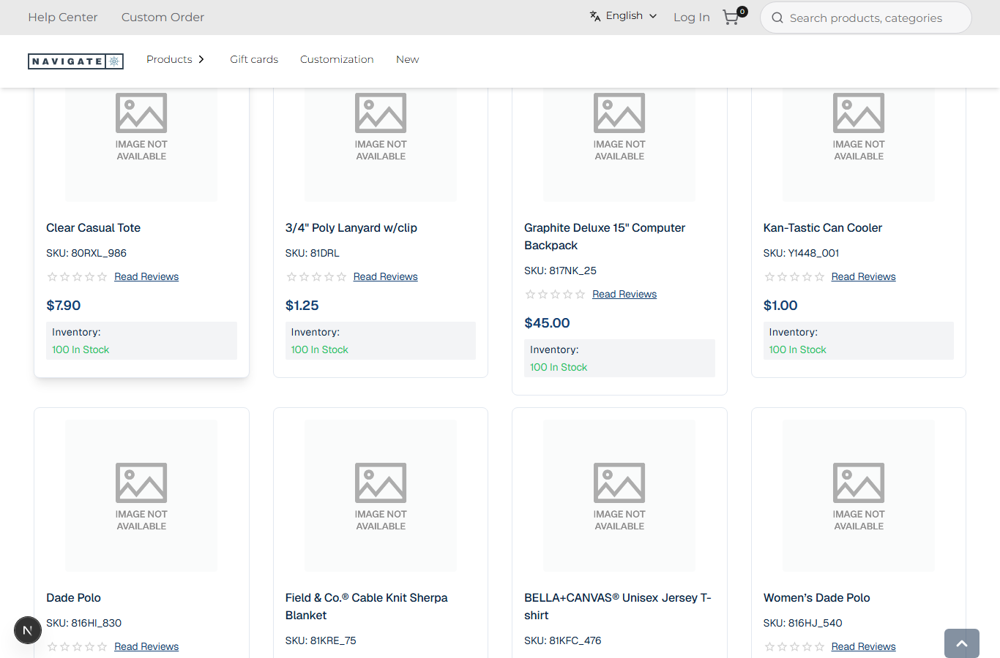
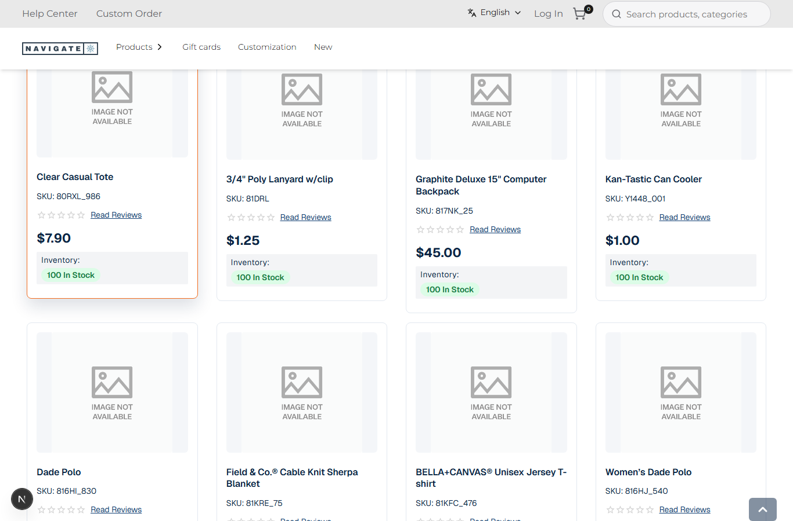

# 029: Can I update the CSS?

**Listed:** Yes. **Result here:** Yes, confirmed.

| Before | After (first card hovered) |
| --- | --- |
|  |  |

Store: POCSppDemo (`sppdemo.localhost:3000`), category **Best Sellers** (`/category/1674`), with the theme previewed.
Product images show "Image not available": these stores take product images from Artifi, which is not part of this
theme.

## The example: a listing-page refresh, CSS only

A common storefront polish, done without touching a component:

| Part | Change |
| --- | --- |
| Card | Quiet border at rest; on hover or keyboard focus it lifts 4 px, gets a shadow and the accent (orange) border |
| Image | Rounded corners on a light backdrop |
| Name | Semi-bold, at most two lines, so cards in a row line up |
| Price | Larger, bold, in the brand navy |
| Stock | "100 In Stock" as a green pill |

Motion is turned off for shoppers who ask for reduced motion (`prefers-reduced-motion`).

## How it renders

**In the webstore (base):** `category/[id]/page.tsx` → page JSON (agent `getPageByPageCode`) → `preparedContentItem` → agent `categoryProductList` → `GET {API_URL}v2.1/categories/{code}/products` → `ProductListPageRender` → `CategoryProductList` → `ProductList` → `ProductViews` → `ProductCard` ([§4 A](../../RENDER-FLOW.md#4-worked-example-the-product-card-on-a-category-page))

**How this customization joins it:** `<RuntimeStyles/>` in the root layout links the theme's stylesheet (`src/styles/listing.css`, built into `spp-customization-<v>.css`) after the store's CSS, served from the plugin folder by `/api/extensions/files/<file>` ([§3 B.1, B.6](../../RENDER-FLOW.md#3-the-page-shell-root-layout-head-styles-labels-server-layout)); the rules target the store card's `.product-card.card` class and `data-test-selector` hooks ([§4 B.2](../../RENDER-FLOW.md#4-worked-example-the-product-card-on-a-category-page))

End-to-end flow, with file and line references in the webstore: [docs/RENDER-FLOW.md](../../RENDER-FLOW.md).

## Where

- `src/styles/listing.css` (new): rules on the store card's own classes (`.product-card.card`) and its
  `data-test-selector` attributes (`divProductImage…`, `hdgProductName…`, `spnRetailPrice…`, `divInStockMessage…`),
  prefixed with `html[data-theme]` so they outrank the store's defaults. Picked up by `"styles": ["src/styles/*.css"]`.
- `scripts/shot.mjs`: `--scroll <px>` and `--hover <selector>` options, for screenshots of hover states.

## How a client does this

Find the element in the browser's inspector, prefer its `data-test-selector` (kept stable for tests) over utility
classes, write the rule in a `src/styles/*.css` file and `npm run deploy`. No store build.
