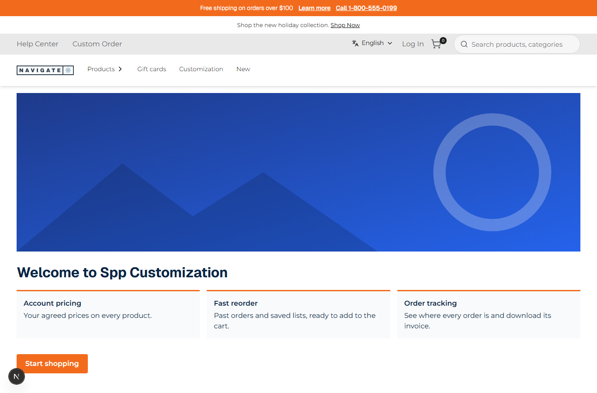
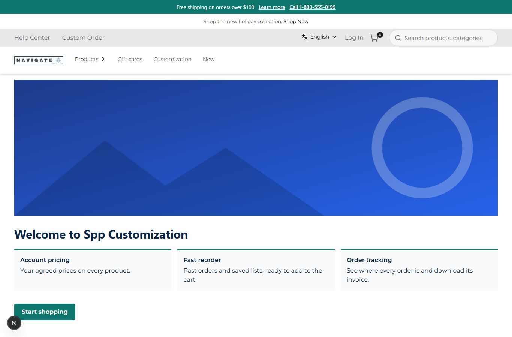

# 030: Can I change fonts and colors per theme?

**Listed:** Yes. **Result here:** Yes, confirmed, and per store without code.

| Theme defaults | A merchant's settings (teal, system headings) |
| --- | --- |
|  |  |

Store: POCSppDemo (`sppdemo.localhost:3000`), the theme's welcome page.

## The example: merchant-configurable brand color and heading font

Store owners want to rebrand a store (a seasonal color, a sister brand) without a developer. The theme's color and
heading font are now **settings**, each bound to a Znode store attribute:

| Setting | Attribute | Values | Changes |
| --- | --- | --- | --- |
| `accentColor` | `ThemeAccentColor` | any CSS color (default `#f26b1d`, SPP orange) | buttons and their borders, hover, focus outline, announcement bar, card accents |
| `headingFont` | `ThemeHeadingFont` | `brand` (Geist, the theme's own file, default), `family` (Montserrat, from the parent theme), `system` | every heading and the announcement bar |

In the screenshots only the settings changed (`#f26b1d` → `#0f766e`, `brand` → `system`): no build, no deploy, a
page refresh. The heading's computed font is `ui-sans-serif, system-ui, -apple-system, "Segoe UI"` (checked in the
browser; it looks close to the brand font at this weight).

## How it renders

**In the webstore (base):** the root layout renders header to footer inside `<RuntimeServerSlot name="layout.root">` ([§3 A](../../RENDER-FLOW.md#3-the-page-shell-root-layout-head-styles-labels-server-layout))

**How this customization joins it:** the theme's server part `serverSlots["layout.root"]` (`ThemeLayout.tsx`) gets the store's page as `children` and the settings (registry or store attribute), and wraps it in a `
` whose CSS variables override the theme's tokens ([§3 B.4](../../RENDER-FLOW.md#3-the-page-shell-root-layout-head-styles-labels-server-layout), [§2 B.3](../../RENDER-FLOW.md#2-which-store-which-packages-every-request))

End-to-end flow, with file and line references in the webstore: [docs/RENDER-FLOW.md](../../RENDER-FLOW.md).

## Where

- `znode-package.json`: new `headingFont` setting (attribute `ThemeHeadingFont`); `accentColor` default `#f26b1d`
- `src/server/ThemeLayout.tsx`: the `layout.root` wrapper turns the settings into CSS variables
  (`--accent`, `--primary-btn-bg`, `--btn-border`, `--hover`, `--focus-outline-color`, `--theme-accent`,
  `--heading-font-family`), which override the theme's defaults (`tokens.css`, `fonts.css`) for the whole page

## How a client does this

- Developer, once: expose the brand choices as settings with an `attribute`, and map them to CSS variables.
- Merchant, any time: set the store attribute in Znode admin (`ThemeAccentColor`, `ThemeHeadingFont`); the value
  applies to that store only. Without the attribute, the value in `plugins.json` applies
  (`node scripts/registry.mjs set accentColor=#0f766e` here).
