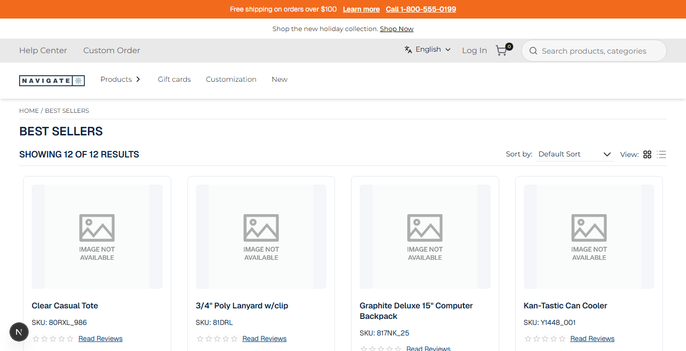
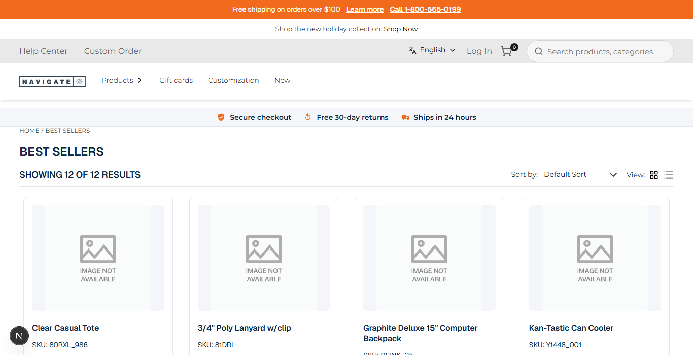

# 031: Is a theme's CSS kept from clashing with the store's own CSS?

**Listed:** Yes. **Result here:** Yes, confirmed.

| Before | After (trust strip under the header) |
| --- | --- |
|  |  |

Store: POCSppDemo (`sppdemo.localhost:3000`), category Best Sellers.

## The example: a trust strip copied from a live site, without breaking the store

Most storefronts show reassurance near the top ("Secure checkout · Free 30-day returns · Ships in 24 hours"). Here the
strip's markup and CSS come "from the client's live site", which is where clashes start: that CSS repeats utility
classes the store already has (`.flex`, `.items-center`, `.gap-6`, `.text-sm`, ...). Loaded again after the store's
stylesheet, those copies would win over the store's responsive variants (`md:...`, `lg:...`) and break layouts
elsewhere on the page.

How each kind of clash is kept away:

| Risk | Protection | Shown by |
| --- | --- | --- |
| Copied rules the store already has | `"dedupeStyles": true`: at build, rules the store's page already has are dropped | build: `css-dedupe: 8 rules the store already has dropped, 7191 bytes kept`; none of the 8 utilities is in the installed stylesheet |
| The theme's own class names colliding | Every class is prefixed with the package name (`spp-customization-trust`, `...__item`) | `output.txt` |
| Overriding the store's tokens by accident | Token and element rules are scoped to `html[data-theme]` (024, 029) | `tokens.css`, `listing.css` |
| The theme's CSS reaching other stores | Only the active theme chain's stylesheets are linked: POCStaplesPromo loads spp-base, artifi and countdown-banner, never `spp-customization` | `/api/extensions` on `staplespromo.localhost:3000` |

## How it renders

**In the webstore (base):** the layout JSON's header item → agent `getHeaderInitialDetails` (portal logo, mega-menu categories) → `HeaderRender` → `Header` (`<header id="webstore-header">`) ([§8 A](../../RENDER-FLOW.md#8-header-footer-search))

**How this customization joins it:** the build drops the copied rules the store's page already has (`dedupeStyles`) ([§1](../../RENDER-FLOW.md#1-from-this-repository-to-the-store-install-registry)); `<RuntimeStyles/>` in the root layout links the theme's stylesheet (`src/styles/trust-strip.css`, built into `spp-customization-<v>.css`) after the store's CSS, served from the plugin folder by `/api/extensions/files/<file>` ([§3 B.1, B.6](../../RENDER-FLOW.md#3-the-page-shell-root-layout-head-styles-labels-server-layout)); `HeaderRender` → `RuntimeHeader` → `<RuntimeSlot name="layout.header">`: the theme's `AnnouncementBar` slot gets the store's header as `children` and renders its bars around it ([§8 B](../../RENDER-FLOW.md#8-header-footer-search)) and adds `TrustStrip` after the header

End-to-end flow, with file and line references in the webstore: [docs/RENDER-FLOW.md](../../RENDER-FLOW.md).

## Where

- `src/slots/TrustStrip.tsx` (new): the strip (three items with inline SVG icons, `aria-label`, `aria-hidden` icons)
- `src/slots/AnnouncementBar.tsx`: `layout.header` slot renders the strip below the store's header
- `src/styles/trust-strip.css` (new): the copied utilities (dropped at build) and the component's own rules (kept)
- `znode-package.json`: `"dedupeStyles": true`; new setting `showTrustStrip` (default on)

## How a client does this

Keep copied CSS as it is, turn on `"dedupeStyles": true`, and build with a store running (`STORE_URL`, default
`http://staplespromo.localhost:3000/`): only the rules the store lacks are shipped. Prefix your own classes with the
package name.
