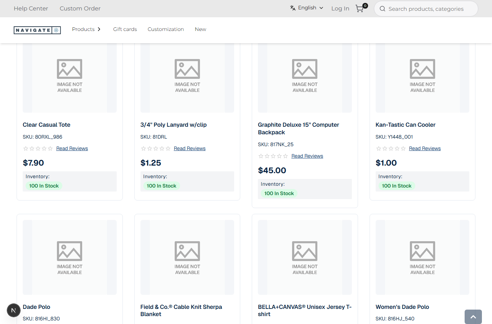
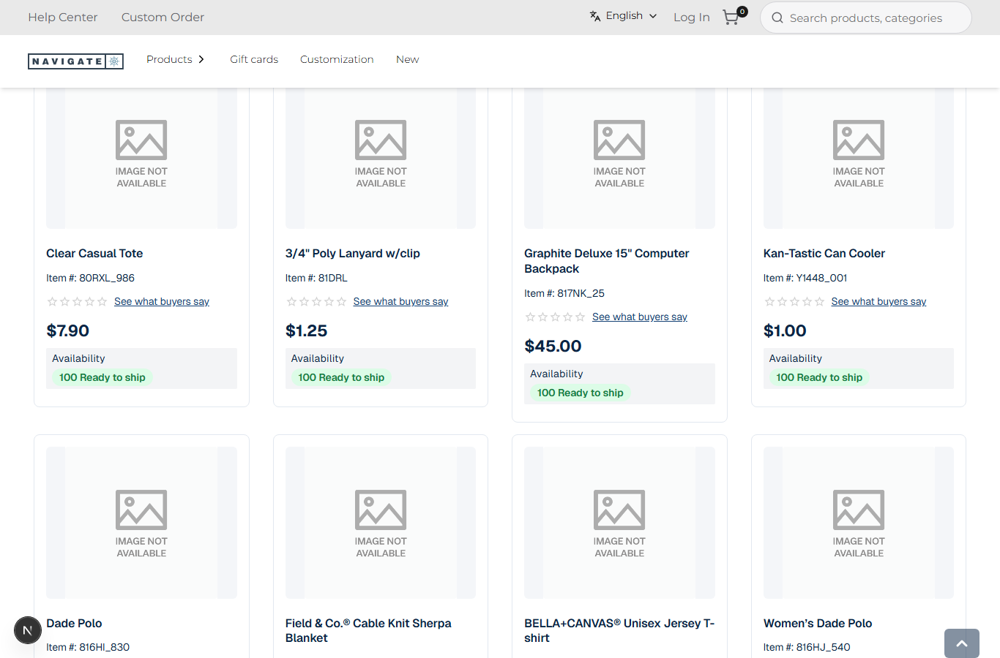

# 032: Can I change labels and messages per theme?

**Listed:** Yes. **Result here:** Yes, confirmed.

| Before | After |
| --- | --- |
|  |  |

Store: POCSppDemo (`sppdemo.localhost:3000`), category Best Sellers.

## The example: the store's labels in the brand's B2B voice

Branded-merchandise buyers order for a company, so the theme speaks their language instead of the generic retail
wording:

| Store label (key) | Default | This theme |
| --- | --- | --- |
| `Product.sku` | SKU | Item # |
| `Product.readReviews` | Read Reviews | See what buyers say |
| `Product.inventory`, `Product.labelInventory` | Inventory | Availability |
| `Product.inStock`, `Product.textInStock` | In Stock | Ready to ship |
| `Product.addToCart`, `Common.addToCart` | Add to Cart | Add to order |

Only the keys listed change; every other label stays the store's. Stores not on this theme keep the defaults.

## How it renders

**In the webstore (base):** `apps/webstore/src/i18n/request.ts` loads `messages/<locale>.json`; components read labels through next-intl (`Product.sku`, …) ([§3 B.7](../../RENDER-FLOW.md#3-the-page-shell-root-layout-head-styles-labels-server-layout))

**How this customization joins it:** `withRuntimeMessages` deep-merges the theme's `src/i18n/labels.json` over the store's messages, so the same components print the theme's wording ([§3 B.7](../../RENDER-FLOW.md#3-the-page-shell-root-layout-head-styles-labels-server-layout))

End-to-end flow, with file and line references in the webstore: [docs/RENDER-FLOW.md](../../RENDER-FLOW.md).

## Where

- `src/i18n/labels.json`: next-intl namespaces and keys, the same as the store's
  `apps/webstore/messages/en-US.json` (store repo); merged over the store's messages for the stores the theme runs on
- `znode-package.json` `"messages": "src/i18n/labels.json"` (already there)

## How a client does this

Find the text in the store's `messages/en-US.json`, copy its namespace and key into `src/i18n/labels.json` with the
new wording, `npm run deploy`. Translations per language: 139.
