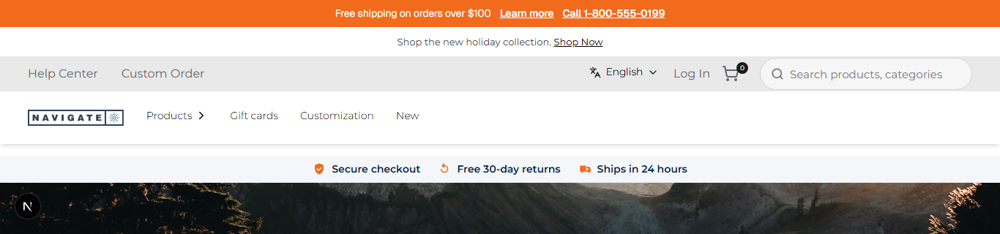
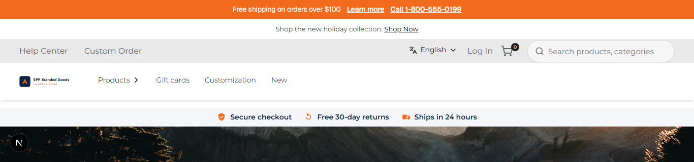
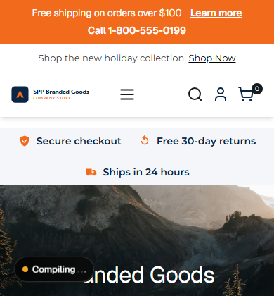

# 033: Can I change logos and images per store?

**Listed:** Yes. **Result here:** Yes, confirmed.

| Before | After (desktop) | After (phone) |
| --- | --- | --- |
|  |  |  |

Store: POCSppDemo (`sppdemo.localhost:3000`).

## The example: a co-branded logo for one store

Company stores often show a co-branded lockup ("SPP Branded Goods · Company Store") instead of the store's usual
logo, and each client's store needs its own. The theme gets a **`logoUrl`** setting bound to the store attribute
**`ThemeLogoUrl`**: when a store has a value, the header shows that image; without one, the store's own logo stays.

- The header component is not replaced: the theme only tells the logo image to show another file, so the logo link,
  alt text, sizes and the mobile menu keep working.
- It covers both headers a store can have: the store's own (`imgDesktopLogo`, `imgMobileLogo`) and the parent theme's
  brand header (`.spp-logo`, `.spp-compact-logo`), on desktop and phone.
- Only site paths (`/...`) and `https://` URLs are accepted, so a setting cannot inject CSS.

## Where

- `znode-package.json`: new setting `logoUrl` (attribute `ThemeLogoUrl`, default empty)
- `src/server/ThemeLayout.tsx`: a valid `logoUrl` becomes `--spp-logo: url("...")` and `data-logo="custom"` on the page
  wrapper
- `src/styles/theme.css`: `.spp-customization-layout[data-logo="custom"]` logo images get `content: var(--spp-logo)`
- `src/assets/spp-customization-cobrand-logo.svg` (new): the co-brand lockup used here

## How a client does this

Per store, set the store attribute `ThemeLogoUrl` in Znode admin to the logo's URL (each store its own value). For a
quick test, the package-wide value: `node scripts/registry.mjs set logoUrl=/api/extensions/files/spp-customization-cobrand-logo.svg`
(used for these screenshots). Settings per store without an attribute: `installations` in `plugins.json` (156).
