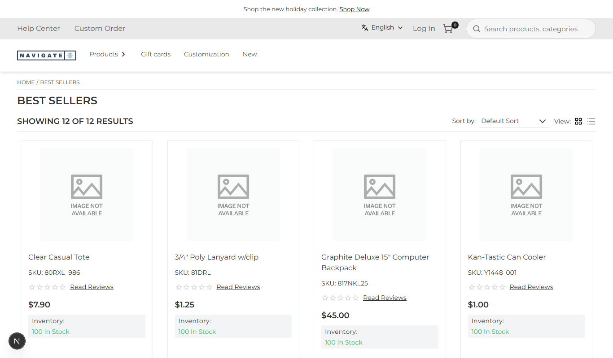
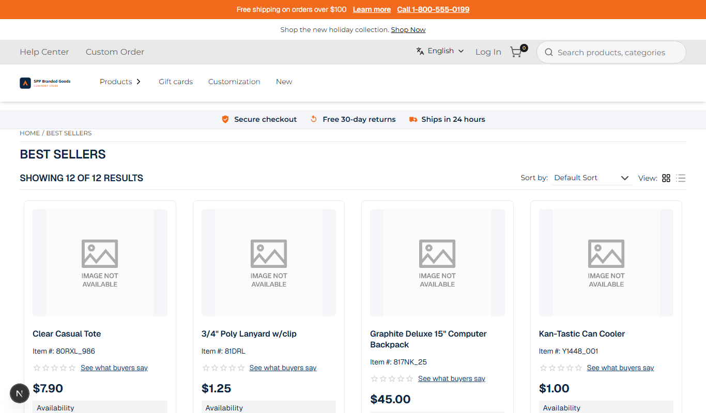

# 034: Can I assign a theme per store?

**Listed:** Yes. **Result here:** Yes, confirmed: spp-customization is now the live theme of the POCSppDemo
(Navigate) store, with no preview cookie.

| Before (store's theme: redpanda) | After (store's theme: spp-customization) |
| --- | --- |
|  |  |

Store: POCSppDemo (`sppdemo.localhost:3000`), category Best Sellers, both shots **without** the preview cookie (what
every shopper sees).

## The example: going live with the new theme on one store

The Navigate store ran the parent theme, redpanda. spp-customization is redpanda's child, so moving the store to it
keeps the family look and adds this theme's work (co-brand logo, trust strip, B2B labels, listing refresh). Other
stores keep their themes.

A store's theme is **the first theme entry in `plugins.json`, in file order, that is on and placed for the store**.
redpanda's entry comes before spp-customization's, so the store is taken off redpanda's list as well:

```
$ node scripts/registry.mjs themes POCSppDemo      (before)
1. redpanda (parent spp-base): on
$ node scripts/registry.mjs stores "" --package redpanda
$ node scripts/registry.mjs stores POCSppDemo
$ node scripts/registry.mjs enable true
$ node scripts/registry.mjs themes POCSppDemo      (after)
1. spp-customization (parent redpanda): on
```

What the store then runs (`/api/extensions`): packages spp-base, spp-customization, artifi, countdown-banner,
delivery-preference; stylesheets `spp-base-1.2.1.css`, `redpanda-1.0.0.css`, `spp-customization-1.0.2.css` (redpanda
still applies, as the parent).

## Where

- `scripts/registry.mjs`: `--package <name>` to change another package's entry (store configuration), and
  `themes <store>` to list a store's themes in the order the store picks them
- `<plugin folder>/plugins.json`: `spp-customization` `"enabled": true`, `"stores": ["POCSppDemo"]`; `redpanda`
  `"stores": []` (changed with the registry lock; the previous file is in `.history/`). No code change, no deploy.

## How a client does this

Put the store code in the theme's `"stores"`, set `"enabled": true`, and make sure no theme earlier in `plugins.json`
is placed for the same store. 035 switches the store back.
