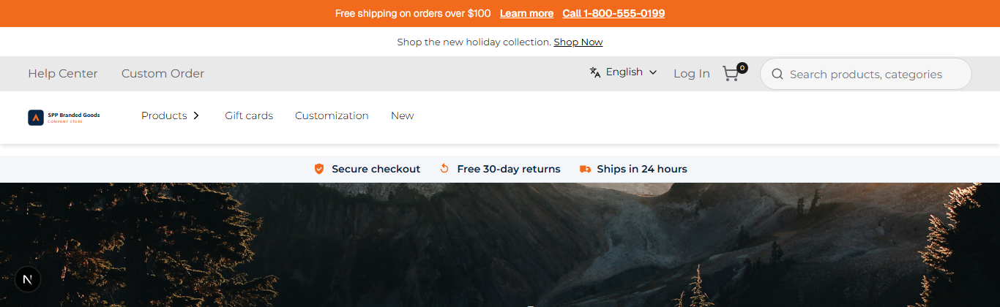
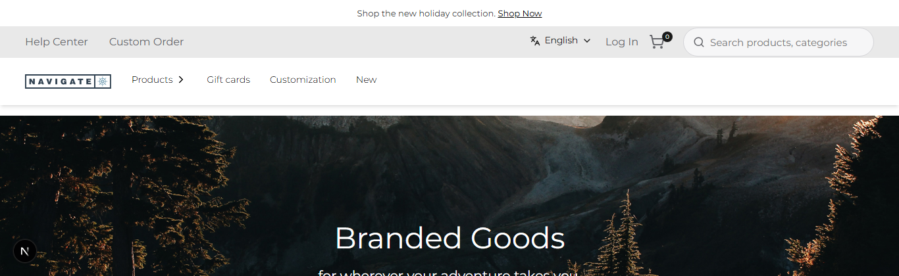

# 035: Can I switch a store's theme without a deploy?

**Listed:** Yes. **Result here:** Yes, confirmed: the live store changed theme within one request (226 ms).

| Before (spp-customization) | After (redpanda) |
| --- | --- |
|  |  |

Store: POCSppDemo (`sppdemo.localhost:3000`), home page, no preview cookie.

## The example: switching a live store back to its previous theme

The opposite of the go-live in 034, as a merchandiser would do after a pilot: the store is moved from spp-customization
back to redpanda with one registry change.

```
$ node scripts/registry.mjs themes POCSppDemo
1. spp-customization (parent redpanda): on
2. redpanda (parent spp-base): on
$ node scripts/registry.mjs stores ""
store picked it up after 226 ms (1 request): packages spp-base, artifi, countdown-banner, delivery-preference;
stylesheets spp-base-1.2.1.css, redpanda-1.0.0.css
```

- No package build, no store build, no deploy, no restart: the webstore process is the same before and after
  (pid 21432, started 12:17:11). The store re-reads `plugins.json` when it changes.
- spp-customization is then switched off again (`enable false`), as it was installed: the store's setup is back to
  the start of 034 (redpanda for POCSppDemo). Only the entries' order differs: spp-customization now comes before
  redpanda, which changes nothing while it has no stores.


## How it renders

**In the webstore (base):** as 012 ([§2 A](../../RENDER-FLOW.md#2-which-store-which-packages-every-request))

**How this customization joins it:** one registry change; the next request reads the new `plugins.json` (mtime) and resolves redpanda ([§1 step 3](../../RENDER-FLOW.md#1-from-this-repository-to-the-store-install-registry), [§2 B.2](../../RENDER-FLOW.md#2-which-store-which-packages-every-request))

End-to-end flow, with file and line references in the webstore: [docs/RENDER-FLOW.md](../../RENDER-FLOW.md).

## Where

`<plugin folder>/plugins.json` only (spp-customization `"stores": []`, `"enabled": false`). No code change.

## How a client does this

Change which theme lists the store in `"stores"` (or switch one off) in `plugins.json`; the next page request uses the
new theme. In production, the same file on the shared plugin folder (DevOps guide, step 4).
