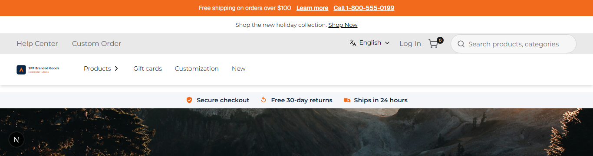
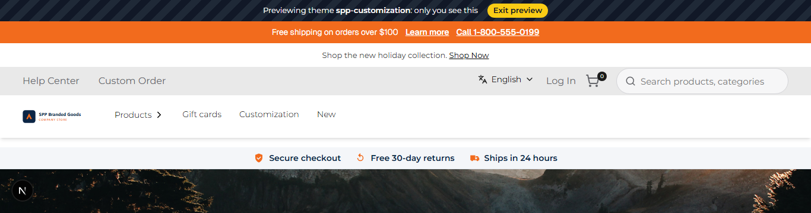
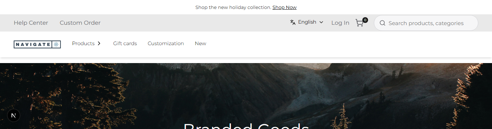

# 036: Can I preview a theme before it goes live?

**Listed:** Yes. **Result here:** Yes, confirmed, with the theme switched off and placed for no store.

| Preview before | Preview after (with the preview bar) | A shopper at the same moment |
| --- | --- | --- |
|  |  |  |

Store: POCSppDemo (`sppdemo.localhost:3000`). The theme's registry entry: `"enabled": false`, `"stores": []`.

## The example: a review link for stakeholders, with a "you are previewing" bar

Before go-live, a merchandiser sends the review link
`http://sppdemo.localhost:3000/api/extensions/preview?theme=spp-customization`: it sets a cookie in that browser only
and shows the store with this theme. Shoppers see the live theme (redpanda) at the same moment.

The risk with cookie previews is forgetting you are in one. As in hosted storefront platforms' theme preview, the
theme now shows a bar at the very top while it is previewed: **"Previewing theme spp-customization: only you see
this"**, with **Exit preview**, which clears the cookie and comes back to the same page
(`/api/extensions/preview?to=<this page>`). It renders nothing on the server and for shoppers, so it costs nothing on
the live store.

## Where

- `src/slots/PreviewBanner.tsx` (new): reads the `runtimeThemePreview` cookie after the page loads (`useEffect`, so
  the server and browser first renders match) and shows the bar when it names this theme
- `src/slots/AnnouncementBar.tsx`: `layout.header` slot renders `<PreviewBanner />` first
- `src/styles/theme.css`: `.spp-customization-preview` (striped dark bar), `.spp-customization-preview__exit`

## How a client does this

Install the theme (it starts switched off), open `/api/extensions/preview?theme=<name>` (add `&to=/some/page` to land
on a page), and `/api/extensions/preview` to leave. Available in development, or in production with
`RUNTIME_THEME_PREVIEW=true` (163).
