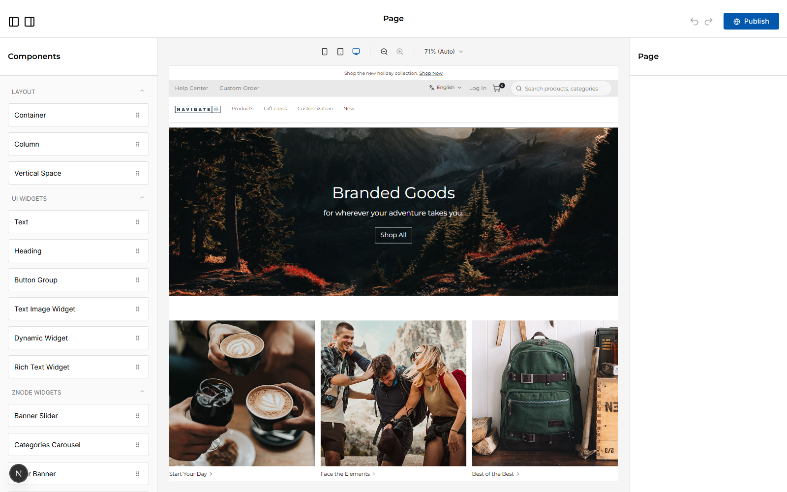
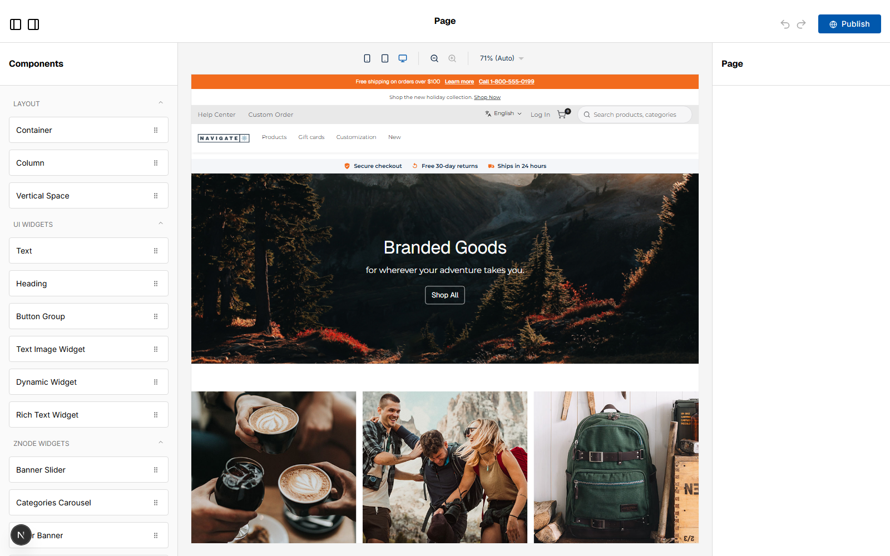

# 037: Does the theme show in the page-builder preview?

**Listed:** Yes. **Result here:** Yes, confirmed, after two fixes found on the way.

| Editor, store on redpanda | Editor, store on spp-customization |
| --- | --- |
|  |  |

Page builder: `http://localhost:3001/en-US/page-builder?url=home&storeCode=POCSppDemo`.

## The example: merchandisers edit pages in the theme they will publish

Content editors must see the page as shoppers will. With spp-customization live on POCSppDemo, the editor's canvas
shows the theme around the page being edited: the announcement bar in the brand orange with "Learn more" and the phone
link, and the trust strip under the header. The editor loads the store's runtime packages
(`/api/extensions?store=POCSppDemo` on :3001): spp-base, spp-customization, artifi, countdown-banner,
delivery-preference; stylesheets spp-base, redpanda, spp-customization.

## What had to change

1. **The editor needs the plugin folder too.** The page builder app had no `RUNTIME_PLUGINS_DIR`, so it loaded no
   runtime package ("No configuration for HeroBanner"). Started with `RUNTIME_PLUGINS_DIR=D:/runtime-plugins-store`
   (an environment setting of the page-builder app, like the webstore's; no store-repo file changed).
2. **The editor does not run server slots.** The theme's `layout.root` server slot (which turns the brand settings
   into CSS variables, 030) does not run in the editor canvas, so the bar fell back to the CSS default (the starter's
   blue). Every `var(--theme-accent, ...)` in `theme.css` now falls back to the theme's own token
   (`var(--accent, #f26b1d)`), so the editor shows the brand color. Settings-driven extras that need the server slot
   (the co-brand logo, 033) show on the store, not in the editor.

The page builder shows a store's **live** theme (it has no preview cookie), so for the "after" shot the theme was put
live on POCSppDemo and switched back to redpanda afterwards (the "before" shot).

## How it renders

**In the webstore (base):** the page builder renders the store's page JSON in its canvas ([§9 A](../../RENDER-FLOW.md#9-home-content-and-package-pages-widgets))

**How this customization joins it:** the page builder loads the edited store's manifest (`/api/extensions?store=`), `RuntimePageEditor` → `addRuntimeWidgets` adds the package's widgets (label, category, fields, defaults; fields merged into an existing type) and `linkRuntimeStyles` links the packages' CSS into the editor ([§9 B.4](../../RENDER-FLOW.md#9-home-content-and-package-pages-widgets)); server slots (`layout.root`) do not run in the editor, hence the CSS fallbacks

End-to-end flow, with file and line references in the webstore: [docs/RENDER-FLOW.md](../../RENDER-FLOW.md).

## Where

- `src/styles/theme.css`: accent fallbacks `var(--theme-accent, var(--accent, #f26b1d))`
- `scripts/shot.mjs`: `--url <absolute URL>` to screenshot another app (the editor) as it is
- `.gitignore`: `.claude/` (this machine's launch settings for the page builder)

## How a client does this

Run the page builder with the same `RUNTIME_PLUGINS_DIR` as the webstore, place the theme for the store, open the
editor with `?storeCode=<store>`. Keep the theme's CSS defaults on its tokens so it looks right where server slots
don't run.
