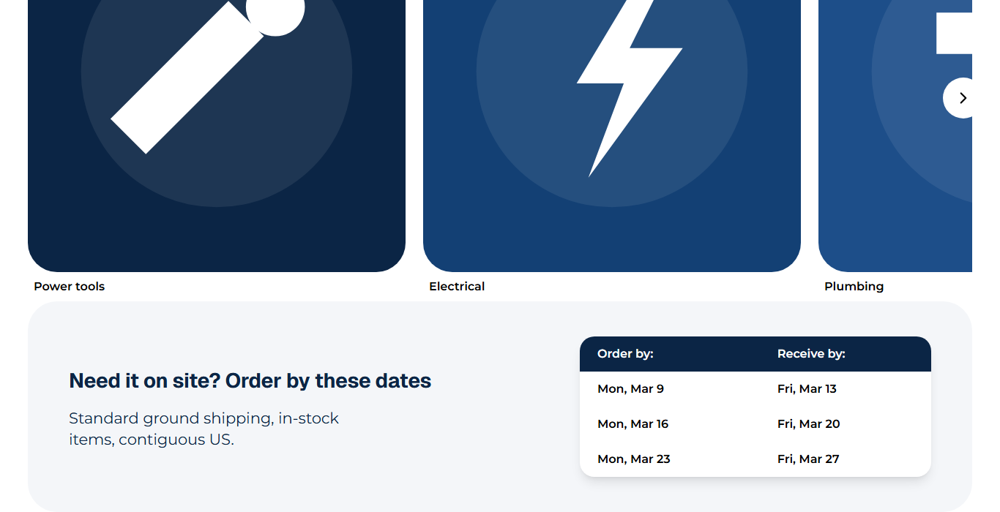
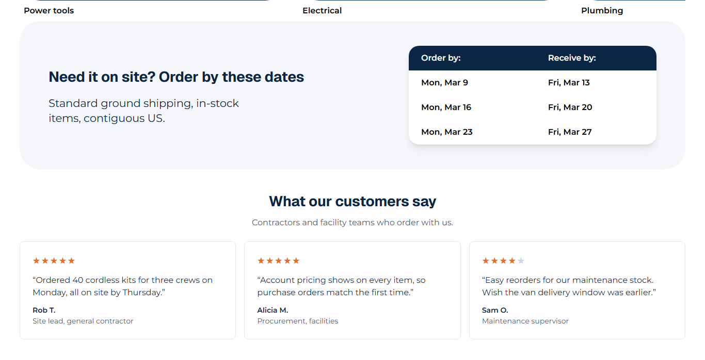
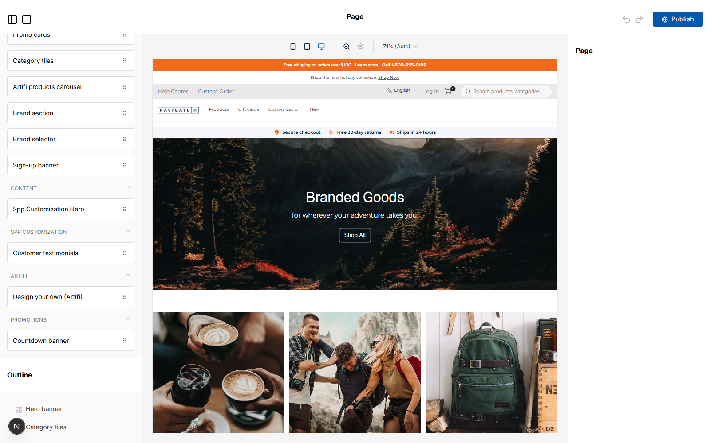

# 038: Can a theme include page-builder widgets?

**Listed:** Yes. **Result here:** Yes, confirmed.

| Before (home page bottom) | After: the widget on the page | After: the widget in the editor |
| --- | --- | --- |
|  |  |  |

Whole page after: [after-full.png](after-full.png). Page: the theme's home page on the Acme store (preview); editor:
the page builder for POCSppDemo, with the theme live there for the shot and switched back afterwards.

## The example: a customer testimonials block

Most storefronts show social proof near the bottom of the home page. The theme ships **Customer testimonials**
(`SppTestimonials`): a heading, a line of text and quote cards with star ratings, name and company. Merchants add it
from the page builder's component list (category **Spp Customization**) and edit its content there; the theme's home
page uses it with sample quotes (placeholder content for this demo, to be replaced by the client's real reviews).

Accessibility: the stars are one image with `aria-label="5 out of 5 stars"`; quotes are `<blockquote>`.

## How it renders

**In the webstore (base):** `[locale]/page.tsx` → `getPage({ url: "home" })` → agent `getPageByPageCode` → `GET {API_URL}v2/visual-editor/pages/…` → `preparedContentItem` → `<PageRender>` ([§9 A](../../RENDER-FLOW.md#9-home-content-and-package-pages-widgets))

**How this customization joins it:** the page builder loads the edited store's manifest (`/api/extensions?store=`), `RuntimePageEditor` → `addRuntimeWidgets` adds the package's widgets (label, category, fields, defaults; fields merged into an existing type) and `linkRuntimeStyles` links the packages' CSS into the editor ([§9 B.4](../../RENDER-FLOW.md#9-home-content-and-package-pages-widgets)); on the store, the page's widget item of that type is carried as `Text { __runtimeWidget }` → `RuntimeTextCarrier` → `RuntimeWidget` renders the package's component in the browser ([§9 B.2](../../RENDER-FLOW.md#9-home-content-and-package-pages-widgets))

End-to-end flow, with file and line references in the webstore: [docs/RENDER-FLOW.md](../../RENDER-FLOW.md).

## Where

- `src/widgets/Testimonials.tsx` (new): the component and its editor definition (`label`, `category`, `fields`:
  text, textarea, an array of quote/name/company/rating, `defaultProps` with sample quotes)
- `src/browser.tsx`: `widgets: { SppTestimonials: { render: Testimonials, ...TESTIMONIALS_EDITOR } }`
- `znode-package.json`: `"widgets": ["SppCustomizationHero", "SppTestimonials"]`
- `src/styles/widgets.css` (new): the cards (three columns from 768 px, one on phones)
- `src/pages/home.json`: the widget at the end of the home page
- `scripts/shot.mjs`: `--find "<text>"` scrolls an element with that text into view (the editor's widget list)

## How a client does this

Write the component and its editor definition, register it under `widgets` in `browser.tsx` and list its type in
`znode-package.json` `"widgets"`, `npm run deploy`. It appears in the page builder for the stores where the theme runs.
