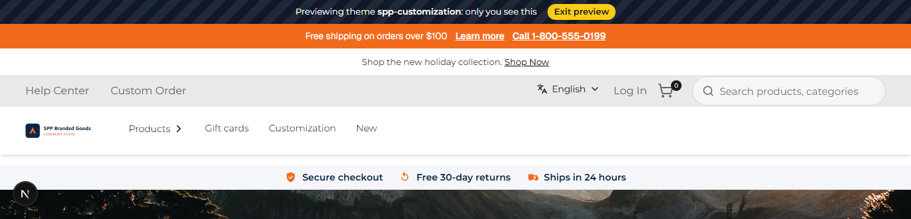
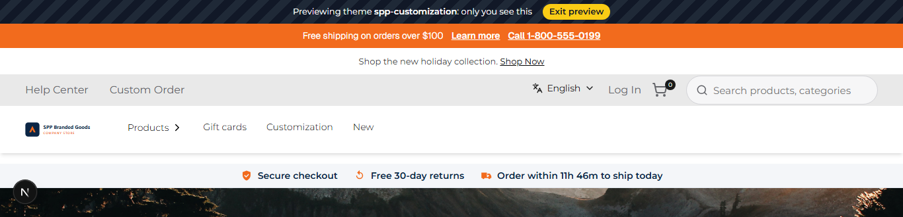

# 039: Can I add routes in a theme?

**Listed:** Partial. **Result here:** Yes: a theme route with its own settings, called from the theme's browser part,
answering only where the theme runs.

| Before | After |
| --- | --- |
|  |  |

Store: POCSppDemo (`sppdemo.localhost:3000`), theme previewed.

## The example: a same-day shipping cutoff countdown

Big retailers show "Order within 3h 12m to ship today" near the top of the page. The theme now has an API route that
works this out from the warehouse's clock, and the trust strip (031) shows its answer:

```
GET /api/extensions/plugins/spp-customization/shipping-cutoff
{"shipsToday":true,"minutesLeft":706,"shipDay":"today","label":"Order within 11h 46m to ship today"}
```

- Settings `shipCutoffHour` (default 15) and `shipTimezone` (default `America/New_York`): orders before the cutoff on
  a weekday ship that day; later, on the next weekday ("ships tomorrow", "ships Monday" over a weekend). Server-only
  settings: they are not sent to the browser.
- The route answers only where the theme runs: under the preview it returns the JSON; on the same store without the
  theme, `404`. The strip then keeps its fixed text "Ships in 24 hours".
- Checked at five moments (before cutoff, one minute before, at cutoff, Friday evening, Saturday): `output.txt`.

## How it renders

**In the webstore (base):** no page: an API route of the theme

**How this customization joins it:** `GET /api/extensions/plugins/spp-customization/shipping-cutoff` → `runPluginRoute` (enabled-for-store check, limits) → the theme's `routes["shipping-cutoff"](request, context)` with `context.settings` ([§7 B.5](../../RENDER-FLOW.md#7-cart-checkout-place-order)); the trust strip fetches it in the browser ([§8 B](../../RENDER-FLOW.md#8-header-footer-search))

End-to-end flow, with file and line references in the webstore: [docs/RENDER-FLOW.md](../../RENDER-FLOW.md).

## Where

- `src/server/shipping.ts` (new): `shippingCutoffAt(now, cutoffHour, timeZone)` (the rule, with `Intl` time zones)
  and the route handler
- `src/server.tsx`: `routes: { highlights, "shipping-cutoff": shippingCutoff }`
- `src/slots/TrustStrip.tsx`: fetches the route after the page loads and shows its label
- `znode-package.json`: settings `shipCutoffHour`, `shipTimezone` (`"permissions": ["routes"]` was already declared)

## How a client does this

Add a function to `routes` in `src/server.tsx` (`(request, context) => data`), declare `"routes"` in `permissions`,
call `/api/extensions/plugins/<package>/<route>` from the browser part. `context` brings the store, the package's
settings, the cart number, the signed-in buyer and the Znode API (95).
