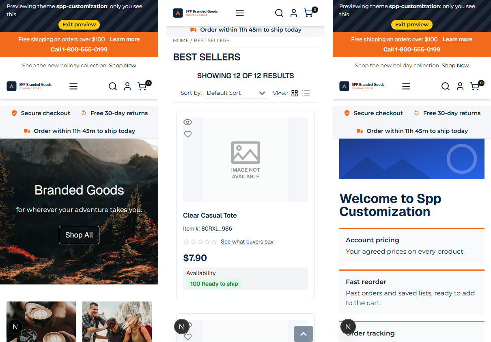
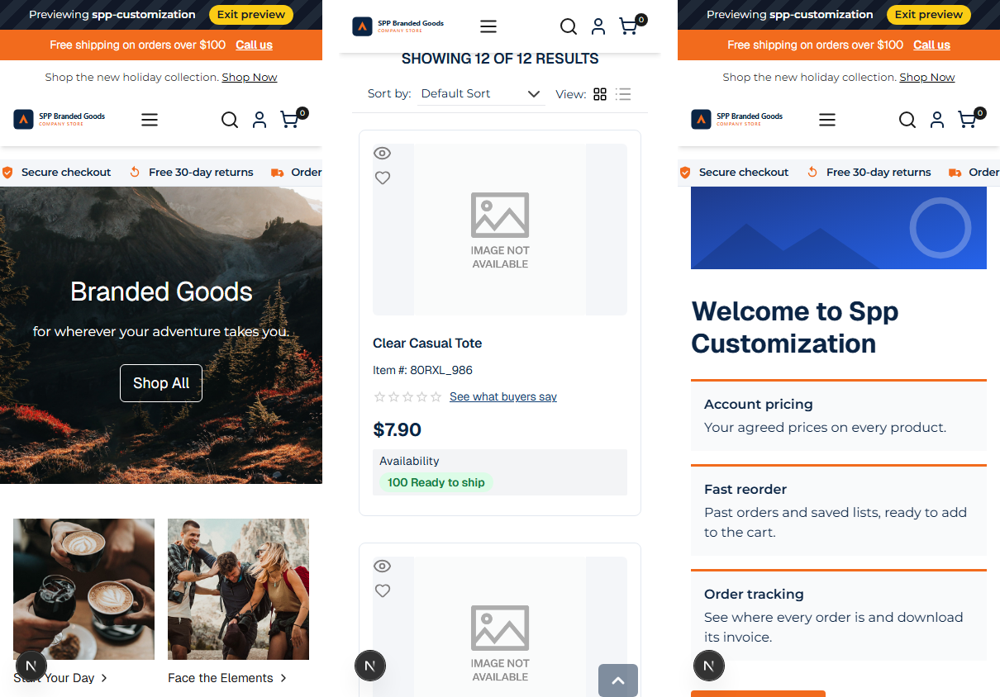

# 041: Does the mobile layout work?

**Listed:** Partial. **Result here:** Yes for everything this theme adds: checked at 390 px on the home page, a
listing and the theme's welcome page, and fixed where it fell short.

Before (home, Best Sellers listing, welcome page at 390 × 844):

After:

Desktop is unchanged: [desktop-check.png](desktop-check.png). Store: POCSppDemo (`sppdemo.localhost:3000`), theme
previewed.

## What was wrong on phones

The store's own layout is responsive; the theme's additions were not. Its three bars wrapped to two lines each, so the
page's content started about **340 px** down a 844 px screen.

## The fix: phone patterns from mobile storefronts

| Part | Phone (< 640 px) |
| --- | --- |
| Preview bar (036) | One line: "Previewing **spp-customization** [Exit preview]" |
| Announcement bar | One line: the message (cut with an ellipsis if long) and a short **Call us** link (`tel:`, with the full number as its accessible name); "Learn more" hidden |
| Trust strip | One **swipeable row** with scroll snap instead of two lines |
| Welcome page title | 26 px, two lines at most |

Content now starts at about **225 px**. The listing (one card per row, the theme's card styles from 029/032) needed no
change.

## How it renders

**In the webstore (base):** the store's responsive layout ([§3 A](../../RENDER-FLOW.md#3-the-page-shell-root-layout-head-styles-labels-server-layout))

**How this customization joins it:** `<RuntimeStyles/>` in the root layout links the theme's stylesheet (`src/styles/mobile.css`, built into `spp-customization-<v>.css`) after the store's CSS, served from the plugin folder by `/api/extensions/files/<file>` ([§3 B.1, B.6](../../RENDER-FLOW.md#3-the-page-shell-root-layout-head-styles-labels-server-layout)); only the theme's own bars (from `layout.header`) change on phones

End-to-end flow, with file and line references in the webstore: [docs/RENDER-FLOW.md](../../RENDER-FLOW.md).

## Where

- `src/styles/mobile.css` (new): the rules under `@media (max-width: 639px)`
- `src/slots/AnnouncementBar.tsx`: phone link has a long ("Call 1-800-555-0199") and a short ("Call us") text
- `src/slots/PreviewBanner.tsx`: the optional words are wrapped so phones can drop them
- `scripts/montage.ps1` (new): puts several screenshots side by side

## How a client does this

Check every page your theme touches at phone width (`node scripts/shot.mjs --width 390 --height 844`), and keep the
theme's additions to one line or a swipeable row on small screens.
