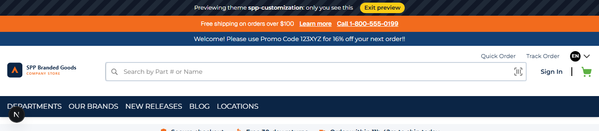
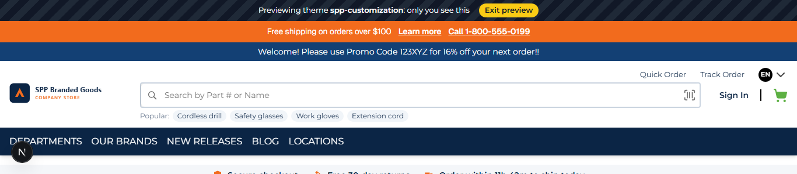
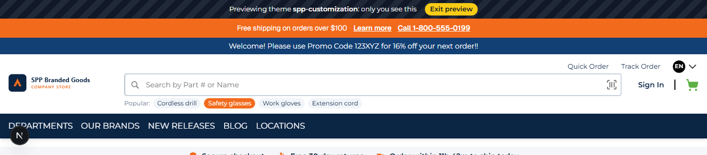

# 042: Can I update a component?

**Listed:** Yes. **Result here:** Yes, confirmed.

| Before | After | After, a term hovered |
| --- | --- | --- |
|  |  |  |

Store: the Acme store (`localhost:3000`), whose header shows the store's own search box; theme previewed.

## The example: "Popular searches" under the search box

Large catalogs help buyers start a search with a few suggested terms. The store's search component stays exactly as it
is (typeahead, barcode scan, its own submit); the theme **adds to it** through its slot:

- Desktop: "Popular:" and up to five term links under the box; each runs the store's normal search
  (`/search?SearchTerm=...`). Placed absolutely, so the header keeps its height.
- Phone: the store renders the search box a second time for phones (`isMobile`); that one is left as it is.
- The terms are the **`popularSearches`** setting (a list), so merchandisers change them without code; default
  "Cordless drill, Safety glasses, Work gloves, Extension cord".

## Where

- `src/slots/SearchWithPopular.tsx` (new): the `header.search` slot; `props.children` is the store's `SearchBox`
- `src/browser.tsx`: `slots: { "header.search": SearchWithPopular }`
- `znode-package.json`: setting `popularSearches` (type `list`)
- `src/styles/theme.css`: `.spp-customization-search*` (term pills, accent on hover / keyboard focus)

## How a client does this

Pick the slot of the component (`extension-api.d.ts` lists them with their props), render `props.children` to keep
the store's component and add around it. To replace it instead, don't render the children (043).
