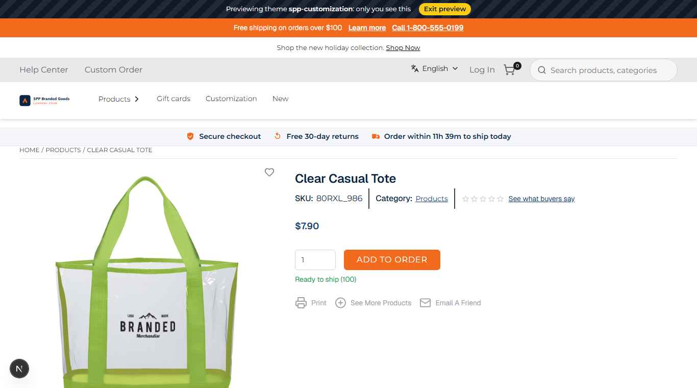
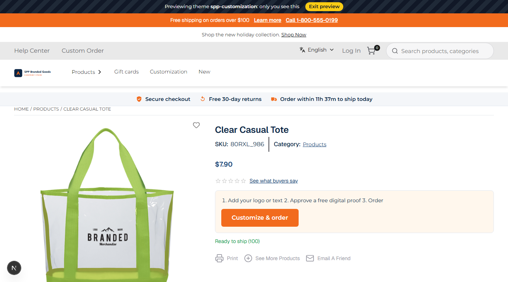
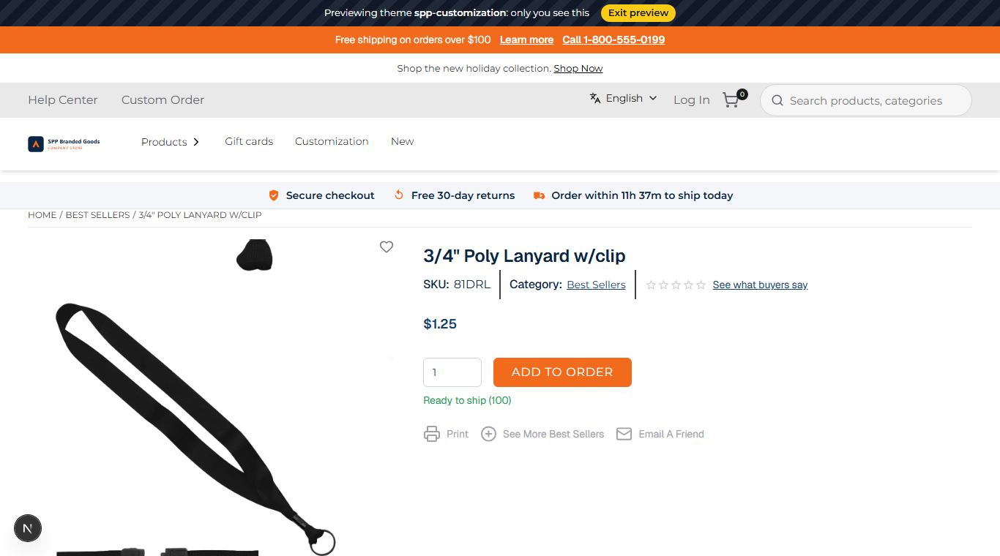

# 043: Can I override an existing component with a runtime package?

**Listed:** Partial. **Result here:** Yes for every component the store wraps with a slot; on this store's built-in
theme (`custom1`) two components are not wrapped, which is what keeps the list's answer at Partial (see below).

| Before (the store's add-to-cart) | After: decorated product | After: other products unchanged |
| --- | --- | --- |
|  |  |  |

Store: POCSppDemo (`sppdemo.localhost:3000`), product pages, theme previewed.

## The example: "Customize & order" for decorated products

Branded merchandise is ordered after the buyer adds a logo, so for those products the store's quantity box and
add-to-cart button make no sense. For the SKUs in the **`customizableSkus`** setting the theme **replaces** the
store's add-to-cart component with:

1. Add your logo or text · 2. Approve a free digital proof · 3. Order — and a **Customize & order** button that opens
the store's customizer with this product (`/customizer?productCode=80RXL_986`).

The store's component is not rendered at all for those products (an override, not a wrapper). Every other product
keeps the store's own quantity box and "Add to order" button (3/4" Poly Lanyard, right).

## Which components can be overridden here

Probed on this store's product and listing pages (temporary probes, removed before the commit):

| Slot | Runs on POCSppDemo (`custom1`) |
| --- | --- |
| `product.addToCart`, `product.layout` | yes |
| `product.image` | no: `custom1`'s product image component is not wrapped |
| `product.card` (listing) | no: the listing renders `znode-widget/product-card`, which has no slot |

Overriding one of the two unwrapped components needs a slot added to that component in the webstore (a base change),
so it stays outside what a package can do on this built-in theme. On the base theme they are wrapped.

## Where

- `src/slots/CustomizeToOrder.tsx` (new): the `product.addToCart` slot; returns the store's `children` unless the SKU
  is listed
- `src/browser.tsx`: `"product.addToCart": CustomizeToOrder`
- `znode-package.json`: setting `customizableSkus` (list, empty by default)
- `src/styles/theme.css`: `.spp-customization-customize*`

Set for the screenshots: `node scripts/registry.mjs set 'customizableSkus=["80RXL_986"]'`.

## How a client does this

In the slot component, return your own element instead of `props.children` (for all products, or under a condition).
