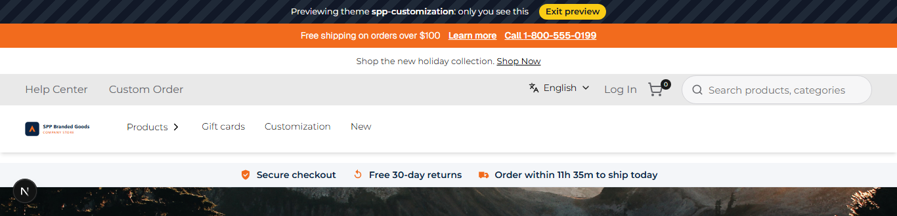
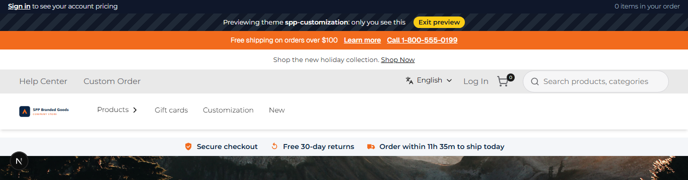

# 046: Can two plugins change the same slot?

**Listed:** Yes. **Result here:** Yes, confirmed: the theme and a plugin both fill `layout.header`, and both show.

| Before (theme only) | After (theme + spp-commerce plugin) |
| --- | --- |
|  |  |

Store: POCSppDemo (`sppdemo.localhost:3000`), theme previewed, plugin placed for the store.

## The example: a B2B account bar from a companion plugin

This repository now holds a second package: **spp-commerce**, the theme's companion plugin (cart and checkout rules
and API take-overs come later: 79-121). A plugin runs for the stores it is placed for, whatever their theme. Its
first feature is the account bar B2B storefronts show above the header: "Sign in to see your account pricing" for
guests, "Signed in as … · your account pricing applies" for buyers, with the order's item count (from the store's
own state hooks, `useUser` and `useCartCount`).

Both packages fill `layout.header`:

| Package | Adds |
| --- | --- |
| spp-customization (theme) | Preview bar, announcement bar, trust strip |
| spp-commerce (plugin) | Account bar |

The store gives each package, as `children`, what the earlier ones rendered, in this order: the theme chain first, then
plugins in `plugins.json` order (`spp-base > spp-customization > artifi > countdown-banner > delivery-preference >
spp-commerce` on this store). Each keeps the children, so everything shows; spp-commerce comes last, so its bar wraps
the rest and sits on top. A package that fails to render is skipped and the others still show (185).

## How it renders

**In the webstore (base):** the layout JSON's header item → agent `getHeaderInitialDetails` (portal logo, mega-menu categories) → `HeaderRender` → `Header` (`<header id="webstore-header">`) ([§8 A](../../RENDER-FLOW.md#8-header-footer-search))

**How this customization joins it:** the theme and the spp-commerce plugin both fill `layout.header`; `RuntimeSlot` passes each one what the earlier rendered (theme chain first, then plugins) ([§3 slot composition](../../RENDER-FLOW.md#3-the-page-shell-root-layout-head-styles-labels-server-layout), [§8 B](../../RENDER-FLOW.md#8-header-footer-search))

End-to-end flow, with file and line references in the webstore: [docs/RENDER-FLOW.md](../../RENDER-FLOW.md).

## Where

- `spp-commerce.znode-package.json` (new): the plugin's manifest, `"kind": "plugin"`, beside the theme's (the SDK
  builds several manifests from one folder: `npx znode deploy spp-commerce.znode-package.json`, output in
  `dist-spp-commerce/`)
- `src/commerce/browser.tsx`, `src/commerce/host.ts`, `src/commerce/slots/AccountBar.tsx`,
  `src/commerce/styles/commerce.css` (new)
- `scripts/deploy.mjs`: `npm run deploy -- <manifest>` deploys either package and keeps its versions
- `.gitignore`: `dist-*/`
- Store: `spp-commerce` placed for POCSppDemo and switched on (`node scripts/registry.mjs stores POCSppDemo --package
  spp-commerce`, `enable true --package spp-commerce`)

## How a client does this

Fill the same slot name in each package and render `props.children` to keep what is already there. 047 is about the
order.
