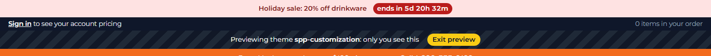
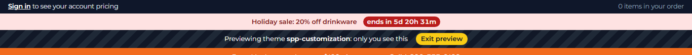

# 047: Can I control the order in which plugins fill a slot?

**Listed:** Partial. **Result here:** Yes between plugins (their order in `plugins.json`), and each package decides
whether it renders above or below what is already there. The one fixed rule: a store's **theme chain always comes
before its plugins**; changing that would be a webstore change.

| Before: spp-commerce, then spp-promos | After: spp-promos, then spp-commerce |
| --- | --- |
|  |  |

Full shots: [before.png](before.png), [after.png](after.png). Store: POCSppDemo, theme previewed.

## The example: which bar goes on top

Two plugins from this repo fill `layout.header` above the theme's bars:

- **spp-commerce**: the B2B account bar (046)
- **spp-promos** (new): a sale countdown bar, "Holiday sale: 20% off drinkware · ends in 5d 20h 32m", from its
  settings `saleText` and `saleEndsAt` (it disappears when the sale is over)

The store chains a slot's packages in this order: theme chain, then plugins as they appear in `plugins.json`; each
package gets what the earlier ones rendered and wraps it, so the **last** package's bar ends up **on top**.

| `plugins.json` order | Top of the page |
| --- | --- |
| `… > spp-commerce > spp-promos` | sale bar, then account bar |
| `… > spp-promos > spp-commerce` (`node scripts/registry.mjs before spp-commerce --package spp-promos`) | account bar, then sale bar |

No code change and no deploy between the two shots: one registry change.

Within a package: render the bar before `props.children` to put it above, after to put it below (the trust strip,
031, renders after the store's header).

## How it renders

**In the webstore (base):** the layout JSON's header item → agent `getHeaderInitialDetails` (portal logo, mega-menu categories) → `HeaderRender` → `Header` (`<header id="webstore-header">`) ([§8 A](../../RENDER-FLOW.md#8-header-footer-search))

**How this customization joins it:** plugins fill a slot in `plugins.json` order (`resolveStoreEntries`); the later one wraps the earlier, so its bar is on top ([§2 B.2](../../RENDER-FLOW.md#2-which-store-which-packages-every-request), [§3 slot composition](../../RENDER-FLOW.md#3-the-page-shell-root-layout-head-styles-labels-server-layout))

End-to-end flow, with file and line references in the webstore: [docs/RENDER-FLOW.md](../../RENDER-FLOW.md).

## Where

- `spp-promos.znode-package.json` (new), `src/promos/browser.tsx`, `src/promos/promos.css` (new): the second plugin
- Store: spp-promos placed for POCSppDemo and switched on; its entry moved before spp-commerce

## How a client does this

Order the plugin entries in `plugins.json` (`scripts/registry.mjs before <package>`); the later one wraps the earlier.
