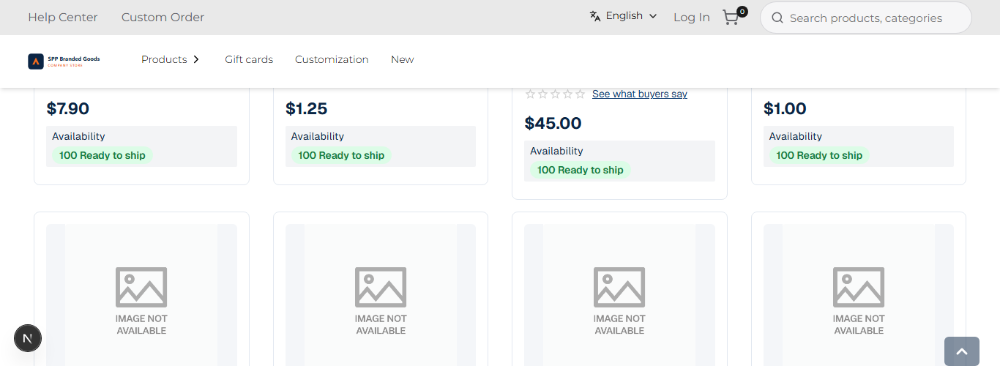
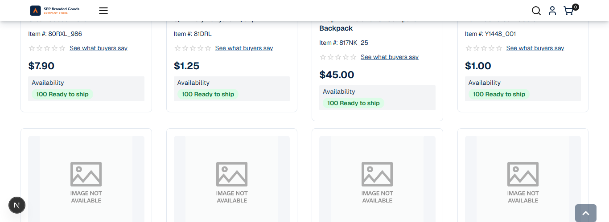

# 048: Can I change the header?

**Listed:** Yes. **Result here:** Yes, confirmed.

| Before: scrolled, tall header (~112 px) | After: scrolled, compact header (~45 px) |
| --- | --- |
|  |  |

At the top of the page the header is unchanged: [after-top.png](after-top.png). Store: POCSppDemo
(`sppdemo.localhost:3000`), Best Sellers scrolled 700 px, theme previewed, desktop (1366 px).

## The example: a compact sticky header on scroll

Long listings lose a lot of screen to a tall sticky header. Many storefronts shrink it once the shopper scrolls: here,
past the first 200 px, the two-row desktop header (utility bar with search + logo/menu row) gives way to one compact
row with logo, menu, search, account and cart, and a soft shadow. Scrolling back to the top restores the full header.

The compact row is the parent theme's own (spp-base uses it on phones), so every control keeps working; the theme
only decides **when** it shows on desktop.

## How it renders

**In the webstore (base):** the layout JSON's header item → agent `getHeaderInitialDetails` (portal logo, mega-menu categories) → `HeaderRender` → `Header` (`<header id="webstore-header">`) ([§8 A](../../RENDER-FLOW.md#8-header-footer-search))

**How this customization joins it:** `HeaderScrollState` (rendered from the `layout.header` slot) sets `html[data-spp-scrolled]`; `<RuntimeStyles/>` in the root layout links the theme's stylesheet (`src/styles/header.css`, built into `spp-customization-<v>.css`) after the store's CSS, served from the plugin folder by `/api/extensions/files/<file>` ([§3 B.1, B.6](../../RENDER-FLOW.md#3-the-page-shell-root-layout-head-styles-labels-server-layout)) ([§8 B](../../RENDER-FLOW.md#8-header-footer-search))

End-to-end flow, with file and line references in the webstore: [docs/RENDER-FLOW.md](../../RENDER-FLOW.md).

## Where

- `src/slots/HeaderScrollState.tsx` (new): a passive scroll listener that sets `html[data-spp-scrolled]` past 200 px
  (renders nothing; writes the attribute only when it changes)
- `src/slots/AnnouncementBar.tsx`: the `layout.header` slot renders `<HeaderScrollState />`
- `src/styles/header.css` (new): from 1024 px, `html[data-spp-scrolled]` hides `.spp-header-wide` and shows
  `.spp-header-compact` with a shadow

## How a client does this

Header changes go in the `layout.header` slot (add above or below the header, or replace it) and in CSS on the
header's classes. Here: a small client component for the scroll state, and CSS for the swap.
