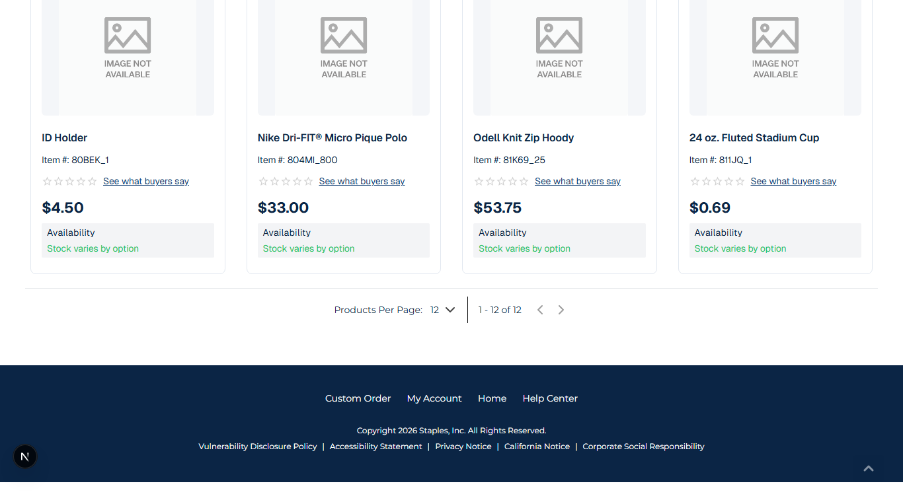
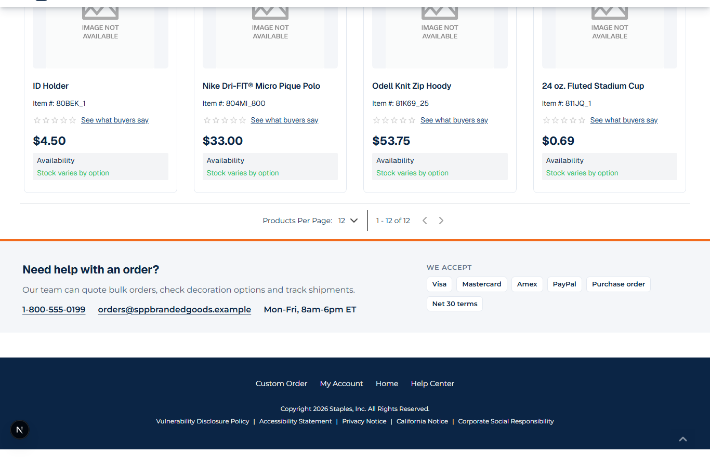
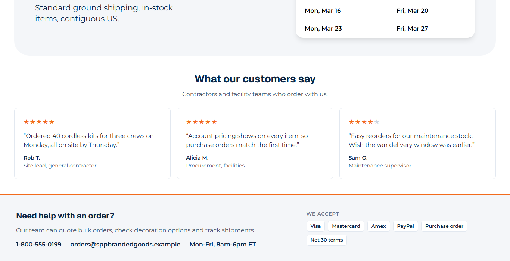

# 049: Can I change the footer?

**Listed:** Yes. **Result here:** Yes, confirmed on both kinds of store header, after fixing where the footer slot
lands on stores with the parent theme's brand header.

| Before (POCSppDemo) | After (POCSppDemo) | After (Acme store) |
| --- | --- | --- |
|  |  |  |

Theme previewed; POCSppDemo Best Sellers and the Acme home page, bottom of the page.

## The example: a "Need help with an order?" band above the footer

B2B buyers look for a person before they place a large order. Above the store's own footer the theme adds a band with
the customer service **phone**, **email** and **hours** (settings `supportPhone`, `supportEmail`, `supportHours`, so
each store can show its own) and the **payment methods** accepted (cards, PayPal, purchase order, Net 30 terms). The
store's footer itself is kept as it is. Items without a value are left out.

## The fix found on the way

The store adds the `layout.footer` slot next to its own header element, after the page has loaded. spp-base's brand
header keeps the store's header in a hidden element, so on POCSppDemo the band was rendered **inside a hidden
element** (checked in the browser: `[data-runtime-slot="layout.footer"]` inside `[hidden]`) and never showed. Once
mounted, the band now moves its slot container to just before the visible store footer (or the end of the page),
which also places it consistently on every store.

## How it renders

**In the webstore (base):** the layout JSON's footer → `FooterRender` (`<footer>` with page-builder content) ([§8 A.3](../../RENDER-FLOW.md#8-header-footer-search))

**How this customization joins it:** `RuntimeHeader` adds a `[data-runtime-slot="layout.footer"]` container next to `#webstore-header` and portals `<RuntimeSlot name="layout.footer">` into it; `FooterHelp` moves that container before the visible footer ([§8 B](../../RENDER-FLOW.md#8-header-footer-search))

End-to-end flow, with file and line references in the webstore: [docs/RENDER-FLOW.md](../../RENDER-FLOW.md).

## Where

- `src/slots/FooterHelp.tsx` (new): the `layout.footer` slot, with `useVisibleFooterSlot()` (the move described above)
- `src/browser.tsx`: `"layout.footer": FooterHelp`
- `znode-package.json`: settings `supportEmail`, `supportHours` (`supportPhone` from 015)
- `src/styles/footer.css` (new): the band (two columns from 900 px)

## How a client does this

Fill `layout.footer` (it has no children: what you render is added at the end of the page). On a store whose header
is replaced by a parent theme, check that it is visible.
