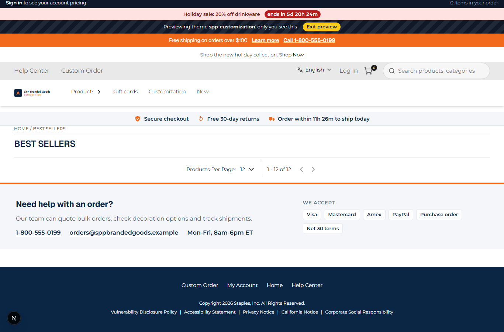
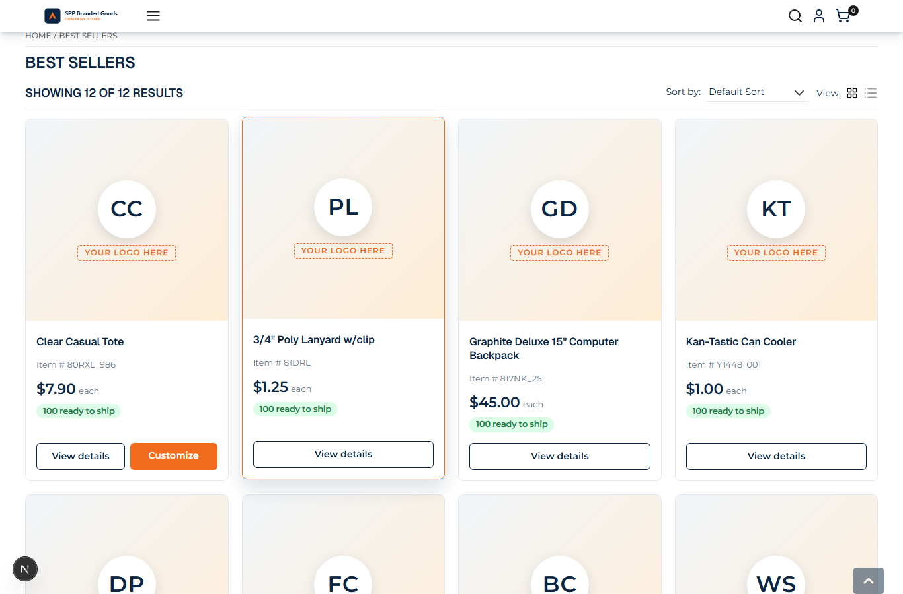
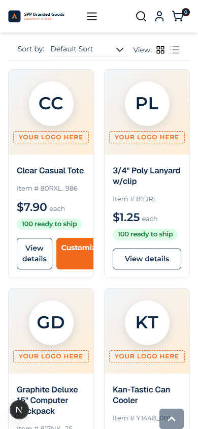

# 050: Can I change the product card?

**Listed:** Yes. **Result here:** Yes, confirmed, with the theme's own card on this store's listing.

| Before (the store's card) | After (the theme's card, one hovered) | After, phone |
| --- | --- | --- |
|  |  |  |

Store: POCSppDemo (`sppdemo.localhost:3000`), Best Sellers, theme previewed.

## The example: a B2B promotional-products card

Promo-product stores sell blanks that get the buyer's logo, so the card says so. The theme's card shows:

- a **"Your logo here"** image placeholder with the product's initials when the product has no listing image (this
  store's listing images are empty: they come from Artifi on the product page only), or the image when there is one
- name, **Item #**, price **"each"**, a stock pill ("100 ready to ship" / out of stock in red)
- **View details**, and **Customize** (opens the customizer) for the SKUs in `customizableSkus` (043)
- a hover / keyboard-focus lift with the accent border; 2 columns on phones, 3 on tablets, 4 on desktop

## How, on this store

The theme takes the **listing** slot (`productList.layout`), which receives the page's products, and draws the grid
with its own card. The store's sort / count / view bar and filter chips are kept as **parts**
(`part("productList.filter")`, `part("productList.facets")`): the store's own components, logic intact.

**Two ways to change a product card**: wrap or replace the store's card through `product.card` (it runs on this
store: the theme's `ProductBadge.tsx` wraps every card), or draw your own card from the listing's data through
`productList.layout`, as here. The second also controls the grid around the cards (quick filters in 054). Correction:
the first version of this page said the store's listing card had no `product.card` slot here; it does (043).

**Fallback, fixed after this scenario**: when the theme does not draw the listing (`themeCards: false`, or a listing
with more than one page, since the paging is not a part), the store's own listing must show. While a package fills
`productList.layout`, the store keeps its listing mounted but `hidden` and passes the layout no children, so the first
version (which returned `children`) showed an **empty listing**. `StoreListing` now un-hides the store's mounted
listing instead: with `themeCards: false` the 12 store cards are back, each wrapped by the theme's `product.card` slot
([fallback-check.txt](fallback-check.txt)).

## How it renders

**In the webstore (base):** `category/[id]/page.tsx` → page JSON (agent `getPageByPageCode`) → `preparedContentItem` → agent `categoryProductList` → `GET {API_URL}v2.1/categories/{code}/products` → `ProductListPageRender` → `CategoryProductList` → `ProductList` → `ProductViews` → `ProductCard` ([§4 A](../../RENDER-FLOW.md#4-worked-example-the-product-card-on-a-category-page))

**How this customization joins it:** `ProductViews` → `RuntimeProductViews` → `<RuntimeSlot name="productList.layout" { productData, part }>` → `ProductListing` draws the theme's cards from `productData.productList`; the store's sort bar and facets are portaled in as parts; the store's listing stays mounted, hidden, and is shown again for the fallback ([§4 B](../../RENDER-FLOW.md#4-worked-example-the-product-card-on-a-category-page))

End-to-end flow, with file and line references in the webstore: [docs/RENDER-FLOW.md](../../RENDER-FLOW.md).

## Where

- `src/slots/ProductListing.tsx` (new): `ProductCard` and the `productList.layout` slot
- `src/browser.tsx`: `"productList.layout": ProductListing`
- `znode-package.json`: setting `themeCards` (default on)
- `src/styles/product-card.css` (new)

`npm run check`: 0 errors, 1 warning, "reads cookies in the browser", from the preview bar (036) reading the
preview cookie; no secret is kept in a cookie.
