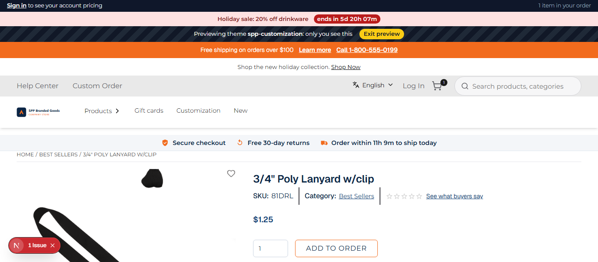
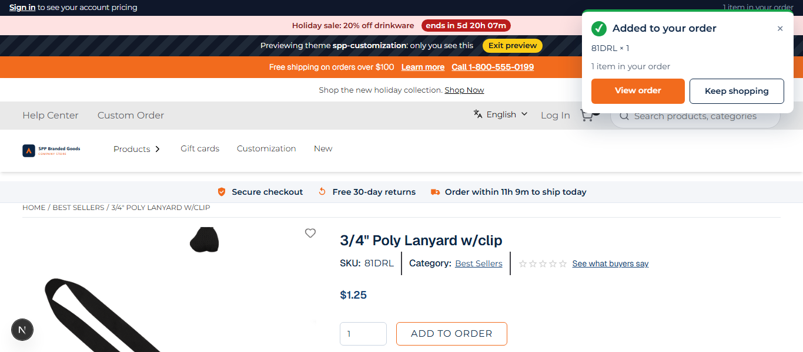

# 051: Can I change the added-to-cart popup?

**Listed:** Yes. **Result here:** Yes, confirmed.

| Before: "Add to order" clicked (no confirmation) | After: the theme's popup |
| --- | --- |
|  |  |

Store: POCSppDemo (`sppdemo.localhost:3000`), 3/4" Poly Lanyard (`/product/103808`), theme previewed, "Add to order"
clicked by the screenshot script (a test cart in the local store).

## The example: an "Added to your order" confirmation

On this store, adding an item only bumps the cart count in the header: the store's popup never appears, so shoppers
are not sure it worked. The theme's popup, standard on most storefronts:

- slides in top right (full width on phones) when the cart's item count goes up, whichever page the item is added on
- shows the item the store reports (SKU **81DRL × 1**; its image when there is one) and the order's item count
- **View order** (to the cart) and **Keep shopping**; closes by itself after 6 s, on ×, or with Escape
- `role="status"` with `aria-live="polite"`, so screen readers announce it; no motion for reduced-motion users

It **replaces** the store's popup (the slot's children are not rendered), so the two never show together on stores
where the store's own does appear.

## How it renders

**In the webstore (base):** click → `useAddToCart` → `POST /api/add-to-cart` → agent `addToCartProduct` → `POST {API_URL}commerceapi/v1/carts/add-to-cart` → cart count and popup data in the store's state ([§6 A](../../RENDER-FLOW.md#6-add-to-cart))

**How this customization joins it:** `AddToCartNotification` → `RuntimeAddToCartNotification` (transform `addToCart.notificationData`) → `<RuntimeSlot name="addToCart.notification" { data }>` → `AddedToCart`, opened by the store's cart count (`host.stores.useCartCount()`) ([§6 B](../../RENDER-FLOW.md#6-add-to-cart))

End-to-end flow, with file and line references in the webstore: [docs/RENDER-FLOW.md](../../RENDER-FLOW.md).

## Where

- `src/slots/AddedToCart.tsx` (new): the `addToCart.notification` slot (props `data`: the store's popup data), opened
  by the store's cart count (`host.stores.useCartCount()`)
- `src/lib/host.ts`: also keeps the browser host, for the store's state hooks
- `src/browser.tsx`: `"addToCart.notification": AddedToCart`
- `src/styles/product-card.css`: `.spp-customization-added*`
- `scripts/shot.mjs`: `--click <selector>` (and `--after <ms>`) to click before the screenshot

## How a client does this

Fill `addToCart.notification` to change the popup (keep `props.children` to add to the store's, or replace it); its
data can also be changed before it shows with the `addToCart.notificationData` transform.
