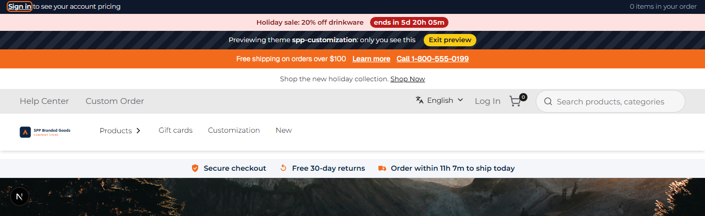
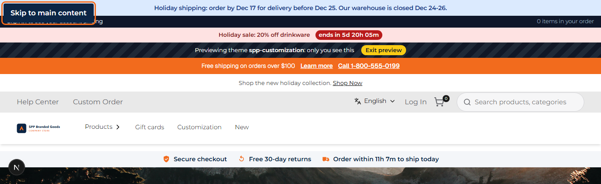

# 052: Can I change the layout code?

**Listed:** Partial. **Result here:** Yes for the page layout from header to footer: the theme's server layout wraps
every page and adds to it in the server HTML. (The `<html>`/`<head>` root is row 53.)

| Before (first Tab press) | After (first Tab press) |
| --- | --- |
|  |  |

Store: POCSppDemo (`sppdemo.localhost:3000`), home page, theme previewed, after pressing Tab once.

## The example: an accessible skip link and a dated holiday notice

Two things almost every serious storefront has in its page layout:

1. **"Skip to main content"**: the page's first focusable element. Keyboard and screen-reader users jump past the
   long header (announcement, account bar, menus, trust strip) straight to the content. Hidden until focused. Before,
   the first Tab landed on a link inside the account bar.
2. **A dated notice** ("Holiday shipping: order by Dec 17 for delivery before Dec 25. Our warehouse is closed Dec
   24-26."), shown only between two dates on the warehouse's calendar (settings `noticeText`, `noticeFrom`,
   `noticeUntil`, time zone `shipTimezone`). Decided on the server, so it is in the page's HTML: no flicker, readable by
   crawlers.

Both are in the server-rendered HTML (`output.txt`), and the date rule was checked at both edges (Oct 31 none, Nov 1
and Dec 26 shown, Dec 27 none).

## How it renders

**In the webstore (base):** the root layout renders header to footer inside `<RuntimeServerSlot name="layout.root">` ([§3 A](../../RENDER-FLOW.md#3-the-page-shell-root-layout-head-styles-labels-server-layout))

**How this customization joins it:** `RuntimeServerSlot` calls the theme's server part `serverSlots["layout.root"]`, which renders the skip link and the dated notice (server-side, from settings) before the store's page ([§3 B.4](../../RENDER-FLOW.md#3-the-page-shell-root-layout-head-styles-labels-server-layout))

End-to-end flow, with file and line references in the webstore: [docs/RENDER-FLOW.md](../../RENDER-FLOW.md).

## Where

- `src/server/ThemeLayout.tsx`: the `layout.root` server slot renders the skip link and the notice before the page
- `src/server/notice.ts` (new): `datedNotice(settings, date)` and `today(timeZone)`
- `src/slots/AnnouncementBar.tsx`: places the skip link's target (`#spp-main`) right after the header
- `znode-package.json`: settings `noticeText`, `noticeFrom`, `noticeUntil` (server only: not sent to the browser)
- `src/styles/theme.css`: `.spp-customization-skip` (shown on focus), `.spp-customization-notice`
- `scripts/shot.mjs`: `--press <key>`

## How a client does this

Server-rendered page chrome goes in the `layout.root` server slot (`serverSlots` in `src/server.tsx`): render
`props.children` (the store's header, page and footer) and add around them.
