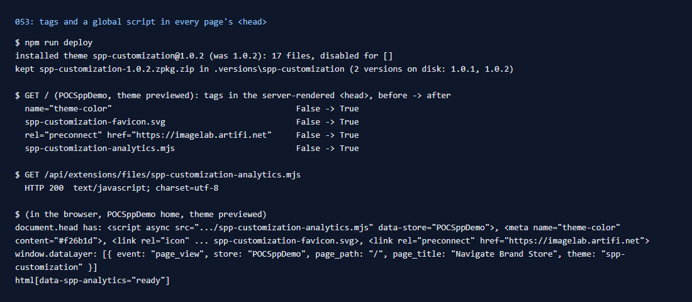

# 053: Can I change the root layout (html/head, global scripts)?

**Listed:** No. **Result here:** Yes for the document `<head>` and global scripts, through the `layout.head` slot
(in the store's root layout, `RuntimeRoot.tsx`). The `<html>`/`<body>` elements themselves stay the store's; a global
script can still set attributes on them in the browser (this one sets `html[data-spp-analytics]`).

Evidence (no visible change on the page: these are head tags): 

## The example: brand and analytics tags in every page's `<head>`

What brands put in the head of every page, server-rendered:

| Tag | Why |
| --- | --- |
| `<meta name="theme-color" content="#f26b1d">` | phones tint the browser toolbar in the brand color (from `accentColor`) |
| `<link rel="icon" href=".../spp-customization-favicon.svg">` | the brand's favicon in tabs and bookmarks |
| `<link rel="preconnect" href="https://imagelab.artifi.net">` | product images from Artifi start loading sooner |
| `<script async src=".../spp-customization-analytics.mjs" data-store="POCSppDemo">` | a global analytics bootstrap: a tag-manager-style `dataLayer` with a `page_view` event (store, path, title) |

Checked: none of the four in the server-rendered `<head>` before, all four after; in the browser, `window.dataLayer`
holds the `page_view` and the script marked the page ready. The analytics script sends nothing anywhere: a real tag
manager's script is added the same way.

## How it renders

**In the webstore (base):** the root layout's `<head>` ([§3 A](../../RENDER-FLOW.md#3-the-page-shell-root-layout-head-styles-labels-server-layout))

**How this customization joins it:** `RuntimeRoot` renders `<RuntimeSlot name="layout.head" { store, theme }>`; `HeadTags` returns `<meta>`, `<link>`, `<script async src>`, which React places in `<head>` on the server render ([§3 B.3](../../RENDER-FLOW.md#3-the-page-shell-root-layout-head-styles-labels-server-layout))

End-to-end flow, with file and line references in the webstore: [docs/RENDER-FLOW.md](../../RENDER-FLOW.md).

## Where

- `src/slots/HeadTags.tsx` (new): the `layout.head` slot
- `src/assets/spp-customization-analytics.mjs` (new): the global script (packages may ship `.mjs`, not `.js`; the
  store serves it as `text/javascript`)
- `src/assets/spp-customization-favicon.svg` (new)
- `src/browser.tsx`: `"layout.head": HeadTags`
- `znode-package.json`: `"assets"` adds `src/assets/*.mjs`

## How a client does this

Render `<meta>`, `<link>` and `<script async src>` from the `layout.head` slot; React places them in the head on the
server render. Ship scripts as `.mjs` assets (or point to a vendor's URL).
