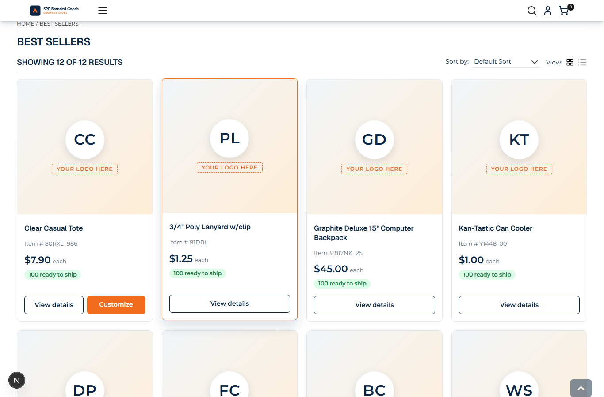
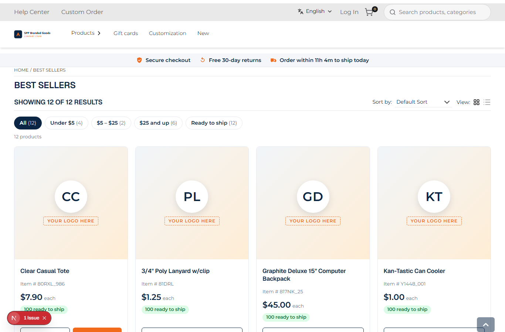
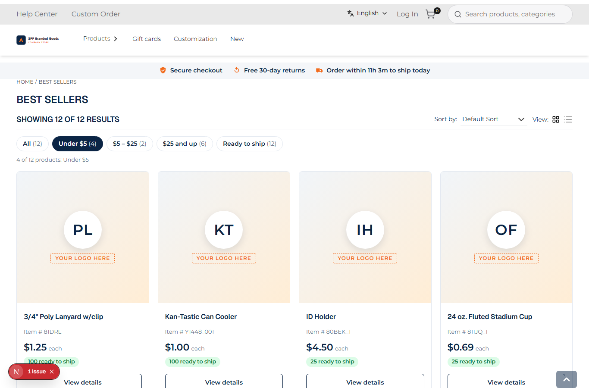

# 054: Can I change the listing layout?

**Listed:** Yes. **Result here:** Yes, confirmed.

| Before | After | After: "Under $5" picked |
| --- | --- | --- |
|  |  |  |

Store: POCSppDemo (`sppdemo.localhost:3000`), Best Sellers, theme previewed.

## The example: quick price filters above the grid

Large catalogs offer one-click shortcuts above the results. The listing layout now has a row of quick filters
between the store's sort/view bar and the grid:

**All (12) · Under $5 (4) · $5 – $25 (2) · $25 and up (6) · Ready to ship (12)**

- each chip shows how many of the page's products it keeps, and is disabled when that is 0
- one at a time, applied instantly (no page load); the store's sort, view and facets stay as they are
- buttons with `aria-pressed`, and a live status line ("4 of 12 products: Under $5") for screen readers

The layout keeps the parts from 050 (the store's sort / count / view bar and facet chips) and the theme's cards.

## How it renders

**In the webstore (base):** `category/[id]/page.tsx` → page JSON (agent `getPageByPageCode`) → `preparedContentItem` → agent `categoryProductList` → `GET {API_URL}v2.1/categories/{code}/products` → `ProductListPageRender` → `CategoryProductList` → `ProductList` → `ProductViews` → `ProductCard` ([§4 A](../../RENDER-FLOW.md#4-worked-example-the-product-card-on-a-category-page))

**How this customization joins it:** as 050: `productList.layout` → `ProductListing`, which now adds the quick filters above the theme's grid ([§4 B](../../RENDER-FLOW.md#4-worked-example-the-product-card-on-a-category-page))

End-to-end flow, with file and line references in the webstore: [docs/RENDER-FLOW.md](../../RENDER-FLOW.md).

## Where

- `src/slots/ProductListing.tsx`: `QUICK_FILTERS` (price bands from `salesPrice` / `retailPrice`, stock from
  `quantity`), chip row and status line in the `productList.layout` slot
- `src/styles/product-card.css`: `.spp-customization-quick*`

## How a client does this

The `productList.layout` slot receives the page's products (`productData.productList`) and `part(name)` refs for the
store's own pieces (`productList.filter`, `productList.facets`): arrange them and add your own around the grid.
