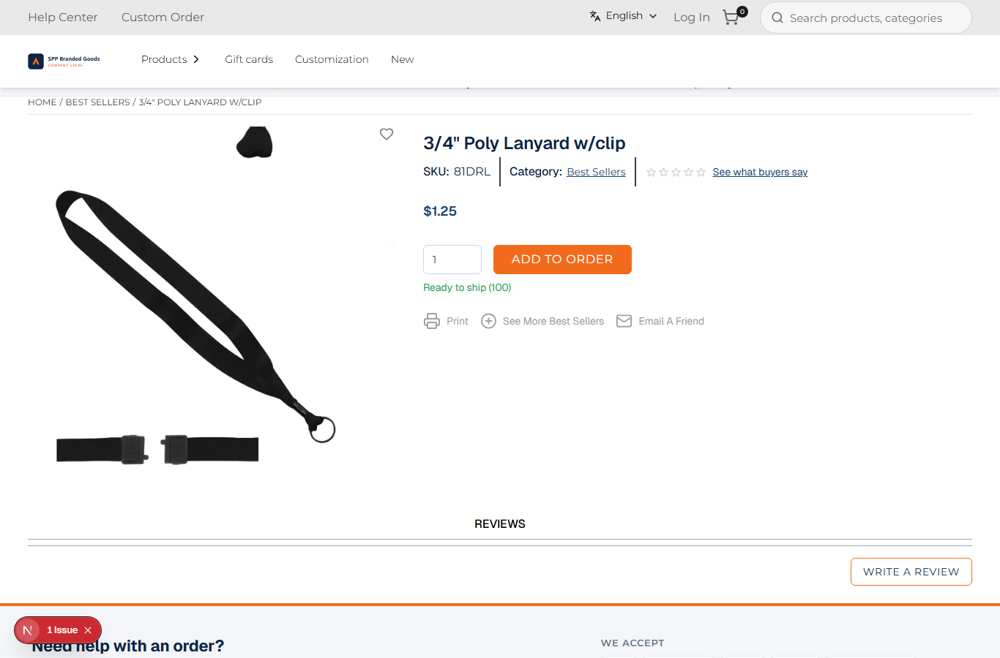
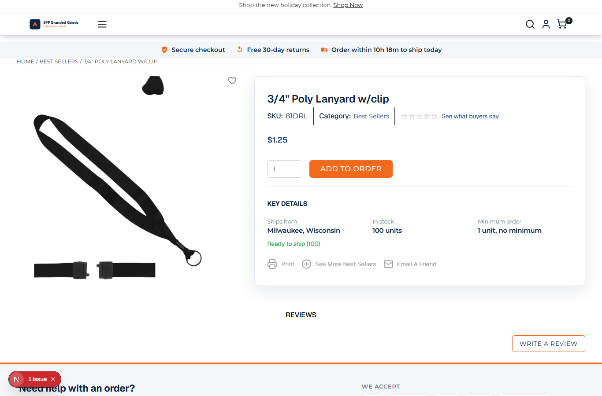

# 055: Can I change the product page layout?

**Listed:** Yes. **Result here:** Yes, confirmed, keeping every store component on the page working.

| Before | After |
| --- | --- |
|  |  |

Store: POCSppDemo (`sppdemo.localhost:3000`), 3/4" Poly Lanyard (`/product/103808`), theme previewed, 1366 px.

## The example: a B2B buy box with key details

- **Buy box**: from 1024 px the product's info column (name, SKU, price, quantity, Add to order) becomes a card beside
  the image, and it is `position: sticky`, so on long product pages (descriptions, specs, reviews) the price and the
  button stay in view. This lanyard's page is short, so there is nothing to scroll past here.
- **Key details** under the button, from the product the store already loaded (no extra request): ships from
  (Milwaukee, Wisconsin), in stock (100 units), minimum order (1 unit, no minimum); maximum per order and typical lead
  time when set; and a **volume pricing** table when the product has price breaks (`tierPriceList`). Facts without a
  value are left out.

## Why not the `product.layout` slot here

`product.layout` lets a theme draw the whole details area and move the store's pieces in as parts (`product.image`,
`product.variants`, `product.addToCart`); the store hides its own details area as soon as a layout takes over. Only
those three pieces move: the product name, SKU, price, ratings and the print / email links would have to be redrawn by
the theme. Changing the layout with CSS on the store's own markup (the info column is found by the product-name heading
it holds) plus a slot for the new panel keeps every store piece, Artifi's image included, with its own logic. (An
earlier version gave a different reason, that the image is not a part here; it is, see the correction in 043.)

## Where

- `src/styles/pdp.css` (new): the buy box (`div:has(> h1[data-test-selector="hdgProductName"])`), the details panel
- `src/slots/ProductFacts.tsx` (new): Key details and volume pricing
- `src/browser.tsx`: `product.addToCart` renders `CustomizeToOrder` (043) then `ProductFacts`

## How a client does this

Restyle the product page's containers with CSS, add content through the product slots (`product.addToCart`,
`product.variants`), and use `product.layout` with `part(name)` on stores where all its parts are wrapped.
