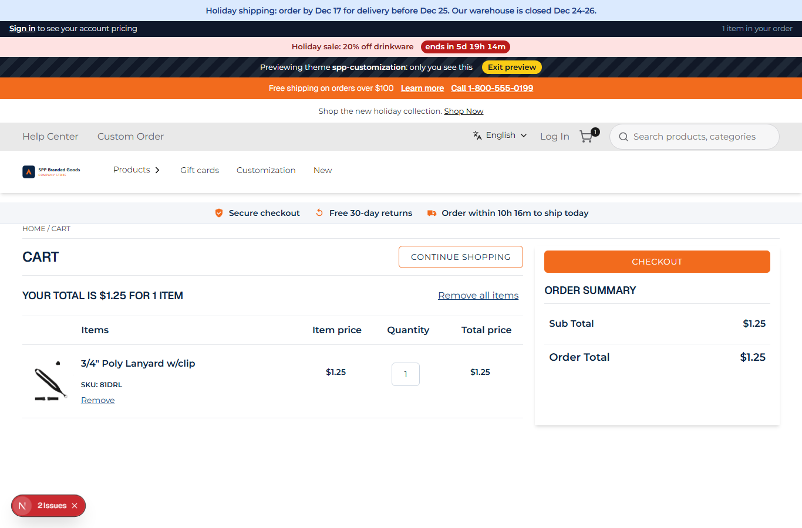
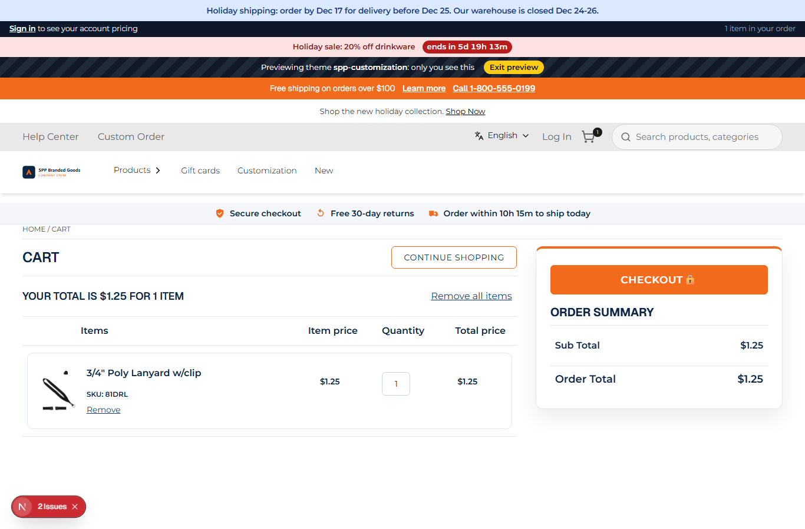

# 056: Can I change the cart page layout?

**Listed:** No. **Result here:** Yes for the layout and look, with CSS on the store's own cart markup. There is still
no cart slot, so replacing cart **components** stays a webstore change (the cart's lines can be changed by a plugin
hook: 112).

| Before | After |
| --- | --- |
|  |  |

Store: POCSppDemo (`sppdemo.localhost:3000`), theme previewed, cart with one item (added by the screenshot script:
Add to order on the lanyard, then `/cart`; a test cart in the local store).

## The example: a checkout-focused cart

The common B2B cart pattern:

- **Columns**: items 2/3, summary 1/3 (at least 320 px), more room between them
- **Order summary** as a sidebar card: accent top border, shadow, bigger order total, full-width **Checkout 🔒**
  button; sticky from 1024 px, so it stays in view while a long cart is reviewed
- **Line items** as cards, product name and line total in bold

The store's cart keeps all its behavior (quantity, remove, totals, checkout): only its styles change.

## How it renders

**In the webstore (base):** cart page → `GET /api/cart/get-cart-items` → agent `getCartItems` → `GET {API_URL}commerceapi/v1/{classType}/item-list/{classNumber}` → `Cart` ([§7 A](../../RENDER-FLOW.md#7-cart-checkout-place-order))

**How this customization joins it:** `<RuntimeStyles/>` in the root layout links the theme's stylesheet (`src/styles/cart.css`, built into `spp-customization-<v>.css`) after the store's CSS, served from the plugin folder by `/api/extensions/files/<file>` ([§3 B.1, B.6](../../RENDER-FLOW.md#3-the-page-shell-root-layout-head-styles-labels-server-layout)); no cart slot ([§7 B](../../RENDER-FLOW.md#7-cart-checkout-place-order))

End-to-end flow, with file and line references in the webstore: [docs/RENDER-FLOW.md](../../RENDER-FLOW.md).

## Where

- `src/styles/cart.css` (new): rules on the cart's `data-test-selector` hooks (`divCartOrderSummaryContainer`,
  `hdgOrderSummary`, `btnCheckout`, `txtProductRowQuantity…`, `linkProductName…`, `paraOrderRowTotal…`) and the
  containers around them (`:has()`), under `html[data-theme]`
- `scripts/shot.mjs`: `--then <path>`, to open the cart after adding an item

## How a client does this

Style the cart through its `data-test-selector` attributes in a theme stylesheet. For new content in the cart, a
plugin's `mapCartItems` / `onCartChanged` hooks (112-114).
