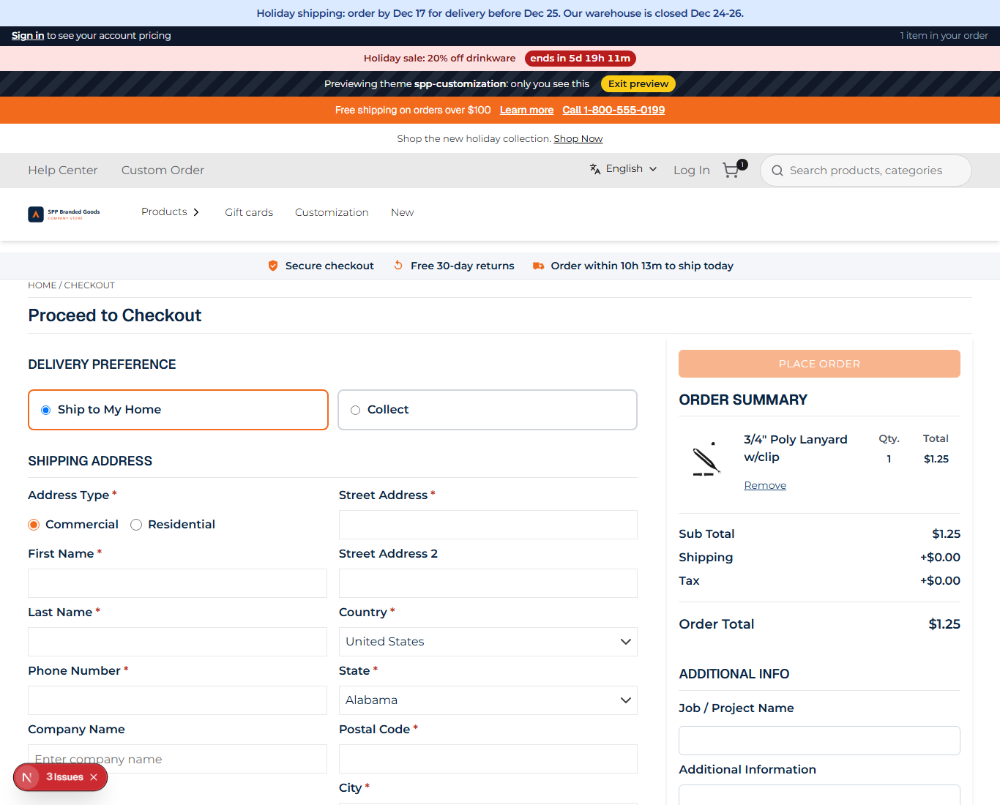
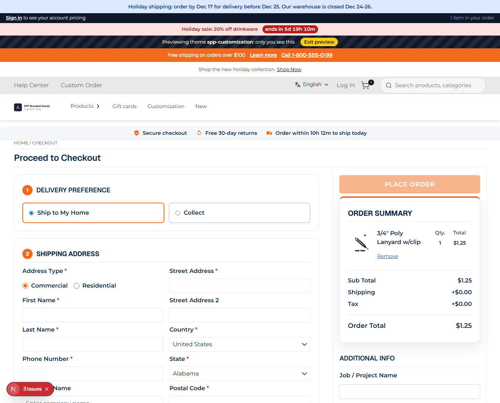

# 057: Can I change the checkout layout?

**Listed:** Partial. **Result here:** Yes for the checkout's layout and look (CSS on the store's checkout markup), and
the address and shipping-method steps take slots (116, 117). The payment step's UI has no slot (118).

| Before | After |
| --- | --- |
|  |  |

Store: POCSppDemo (`sppdemo.localhost:3000`), guest checkout with one item (added by the screenshot script), theme
previewed. The Delivery Preference step comes from the store's `delivery-preference` plugin.

## The example: numbered checkout steps

The checkout pattern most storefronts use:

- every step is a **card** with a **numbered badge** in the accent color: 1 Delivery preference, 2 Shipping address,
  3 Shipping method, 4 Payment (CSS counters, so the numbers follow whatever steps the store shows)
- the **order summary** is a card with an accent top border, sticky from 1024 px; the Place order button is larger

The store's checkout keeps all its behavior (address validation, shipping rates, payment, place order).

## How it renders

**In the webstore (base):** checkout page → `Checkout` → `AddressWrapper`, `ShippingOptions`, payment, summary ([§7 A](../../RENDER-FLOW.md#7-cart-checkout-place-order))

**How this customization joins it:** `<RuntimeStyles/>` in the root layout links the theme's stylesheet (`src/styles/checkout.css`, built into `spp-customization-<v>.css`) after the store's CSS, served from the plugin folder by `/api/extensions/files/<file>` ([§3 B.1, B.6](../../RENDER-FLOW.md#3-the-page-shell-root-layout-head-styles-labels-server-layout)) ([§7 B](../../RENDER-FLOW.md#7-cart-checkout-place-order))

End-to-end flow, with file and line references in the webstore: [docs/RENDER-FLOW.md](../../RENDER-FLOW.md).

## Where

- `src/styles/checkout.css` (new): rules on the checkout's `data-test-selector` hooks (`divDeliveryPreference`,
  `divShippingAddress`, `hdgShippingAddress`, `hdgShippingMethod`, `divPaymentContainer`, `hdgPaymentMethod`,
  `divOrderSummaryContainer`, `btnPlaceOrder`), counter reset on the checkout page (`main:has(hdgCheckout)`)

## How a client does this

Style the checkout through its `data-test-selector` hooks; change what the address and shipping steps contain with the
`checkout.address` and `checkout.shippingOptions` slots.
