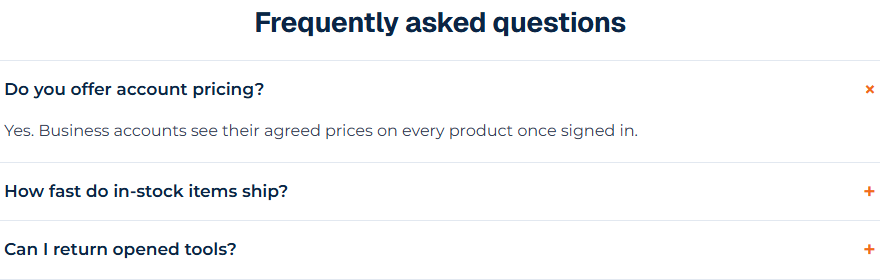
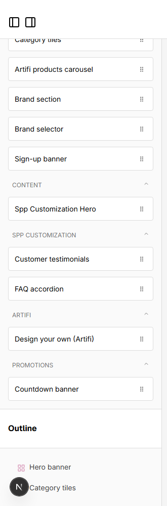

# 059: Can I add a new widget?

**Listed:** Yes. **Result here:** Yes, confirmed.

| The new widget on the page | In the page builder's list |
| --- | --- |
|  |  |

Before, the home page ended with the testimonials: [before.png](before.png). Page: the theme's home page on the
Acme store (preview). Editor: the page builder for POCSppDemo, with the theme live there for the shot and switched
back afterwards. Full editor: [editor.png](editor.png).

## The example: an FAQ accordion

Answers to the questions buyers ask before ordering, on home and help pages. **FAQ accordion** (`SppFaq`):

- a heading and a list of questions; each opens its answer in place, "+" turning into "×"
- native `
` / `
`: works with the keyboard and screen readers, needs no script, and the answers are in
  the page's HTML (findable by search engines)
- editor fields: Heading (text), Open the first answer (radio), Questions (a list of question / answer)
- new blocks start with three sample questions about minimums, decoration proofs and purchase orders

## Where

- `src/widgets/Faq.tsx` (new): the component and `FAQ_EDITOR` (label, category "Spp Customization", fields,
  `defaultProps`)
- `src/browser.tsx`: `widgets: { SppFaq: { render: Faq, ...FAQ_EDITOR } }`
- `znode-package.json`: `"widgets"` adds `SppFaq`
- `src/styles/widgets.css`: `.spp-customization-faq*`
- `src/pages/home.json`: the widget at the end of the home page, with hardware-store questions

## How a client does this

Write the component and its editor definition, register it under `widgets` in `browser.tsx` and list its type in
`znode-package.json` `"widgets"`, `npm run deploy`.
