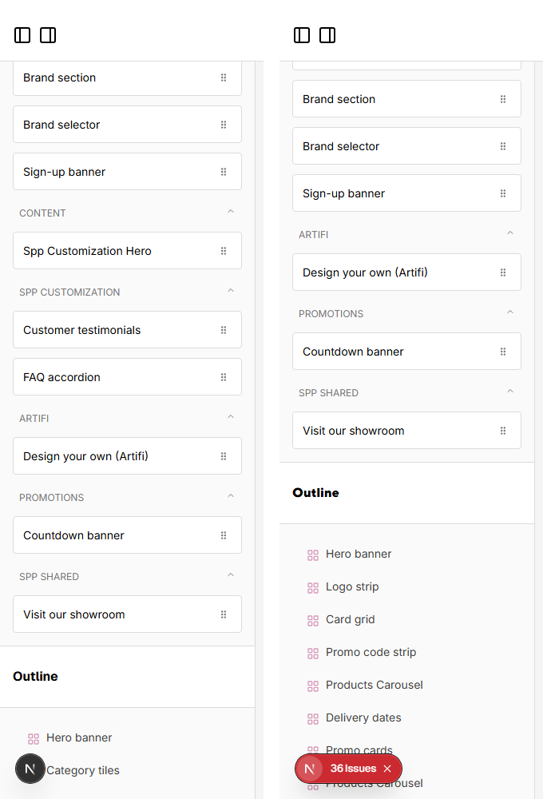

# 060: Can I create a widget in a theme and use it for that theme or globally?

**Listed:** Yes. **Result here:** Yes, confirmed: theme widgets where the theme runs, and a shared widget on every
store.

Page builder widget lists, POCSppDemo (theme live) on the left, POCStaplesPromo (no theme) on the right:



Full editors: [editor-sppdemo.png](editor-sppdemo.png), [editor-staplespromo.png](editor-staplespromo.png).

## The example: theme widgets vs. a shared widget package

| Widget | Package | Where it is offered |
| --- | --- | --- |
| Customer testimonials, FAQ accordion | spp-customization (theme) | only stores whose theme is spp-customization (category "Spp Customization") |
| **Visit our showroom** (new) | **spp-widgets** (`kind: widget`), placed for `"*"` | **every** store, whatever its theme (category "SPP shared") |

**Visit our showroom** is the store-locator block retailers with a will-call counter show: showroom name, address,
phone, a "Get directions" map link and an opening-hours table (rows editable in the page builder).

What each store's page builder loads (`/api/extensions?store=<code>` on the page builder):

```
POCSppDemo        spp-base, spp-customization, artifi, countdown-banner, delivery-preference, spp-promos, spp-commerce, spp-widgets
POCStaplesPromo   spp-base, artifi, countdown-banner, spp-widgets
POCNvidia         spp-base, artifi, countdown-banner, spp-widgets
MaxwellsHardware  apex, spp-widgets
```

spp-customization was live on POCSppDemo only for this check and switched back afterwards; spp-widgets stays placed
for every store.

## How it renders

**In the webstore (base):** the page builder for a store ([§9 A](../../RENDER-FLOW.md#9-home-content-and-package-pages-widgets))

**How this customization joins it:** the editor gets the packages `resolveStoreEntries` returns for that store ([§2 B.2](../../RENDER-FLOW.md#2-which-store-which-packages-every-request)): the theme's widgets where the theme runs, spp-widgets' wherever it is placed; the page builder loads the edited store's manifest (`/api/extensions?store=`), `RuntimePageEditor` → `addRuntimeWidgets` adds the package's widgets (label, category, fields, defaults; fields merged into an existing type) and `linkRuntimeStyles` links the packages' CSS into the editor ([§9 B.4](../../RENDER-FLOW.md#9-home-content-and-package-pages-widgets))

End-to-end flow, with file and line references in the webstore: [docs/RENDER-FLOW.md](../../RENDER-FLOW.md).

## Where

- `spp-widgets.znode-package.json` (new): the third package of this repo, `"kind": "widget"`, `"widgets":
  ["SppShowroom"]`
- `src/shared-widgets/browser.tsx`, `src/shared-widgets/shared-widgets.css` (new)
- `scripts/registry.mjs`: `stores "*"` places a package for every store

## How a client does this

A widget for one look: put it in the theme. A widget for every store: put it in a `kind: widget` package and place it
with `"stores": "*"` (or a list of stores).
