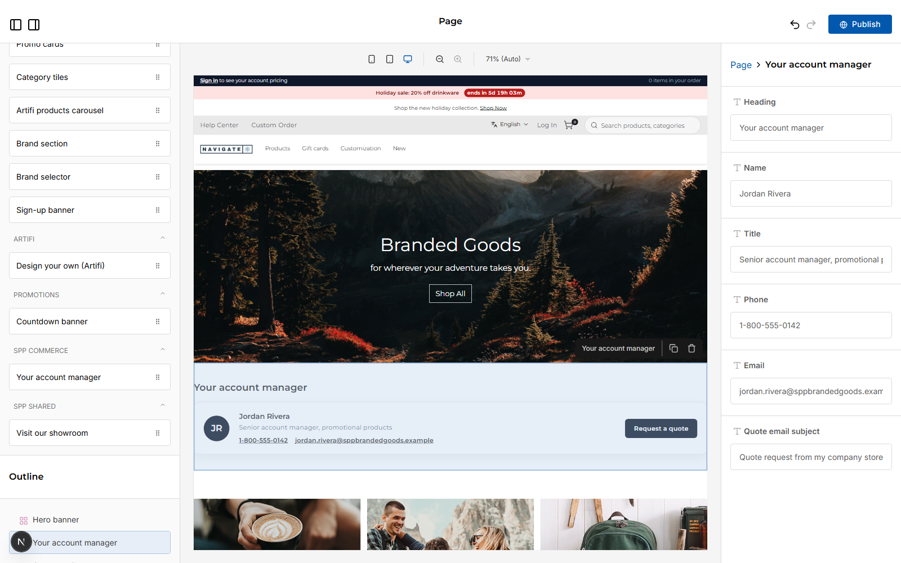

# 061: Can a plugin carry a widget?

**Listed:** Yes. **Result here:** Yes, confirmed.

Page builder for POCSppDemo, whose theme is redpanda: the widget comes from the **spp-commerce plugin**, not from a
theme. It was dragged from the list onto the home page by `scripts/editor.mjs` (not published). The list alone:
[editor.png](editor.png).

## The example: "Your account manager"

B2B storefronts put the buyer's account manager on the home and account pages. **Your account manager**
(`SppAccountManager`, category "SPP commerce"):

- the rep's initials in a circle, name, title, phone and email links
- **Request a quote**: an email to the rep with the subject filled in
- editor fields: Heading, Name, Title, Phone, Email, Quote email subject (right-hand panel), all with sample defaults

Because it ships in a plugin, every store the plugin is placed for offers it, whatever its theme
(`/api/extensions?store=POCSppDemo` on the page builder: `... spp-commerce ...`, theme redpanda).

## Where

- `src/commerce/widgets/AccountManager.tsx` (new): the component and `ACCOUNT_MANAGER_EDITOR`
- `src/commerce/browser.tsx`: `widgets: { SppAccountManager: ... }`
- `spp-commerce.znode-package.json`: `"widgets": ["SppAccountManager"]`
- `src/commerce/styles/commerce.css`: `.spp-commerce-rep*`
- `scripts/editor.mjs` (new): drives the page builder (drag a widget onto the page, optionally type into a field,
  screenshot); never publishes

## How a client does this

Same as a theme widget (`widgets` in the browser part, `"widgets"` in the manifest), in a `kind: plugin` package.
