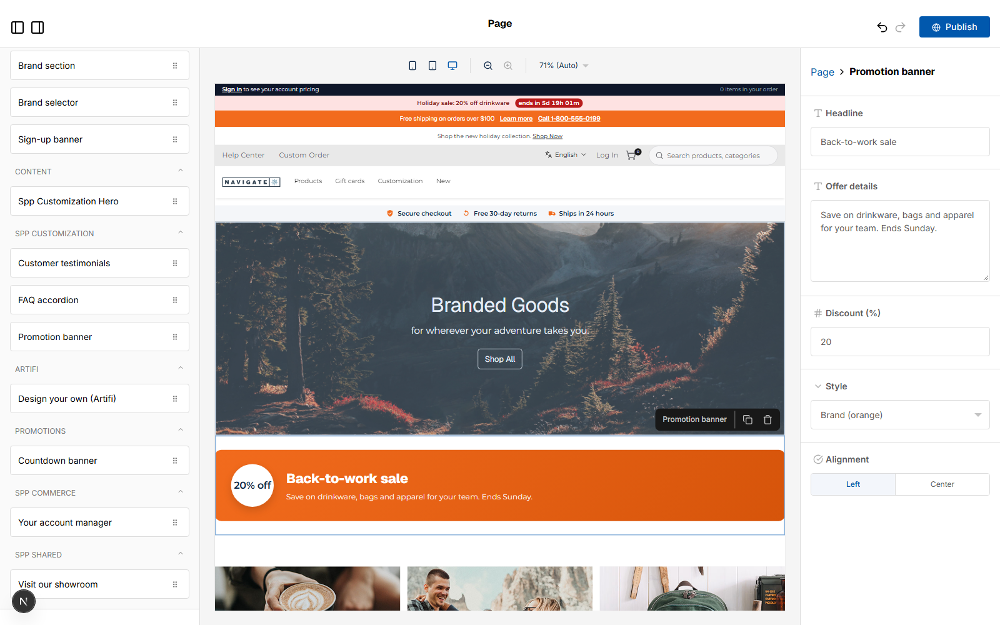

# 062: Can I give a widget settings fields in the page builder?

**Listed:** Yes. **Result here:** Yes, confirmed.

Page builder for POCSppDemo (spp-customization live there for the widget rows, switched back at the end); the widget
dragged onto the home page by `scripts/editor.mjs`, not published.

## The example: a merchandiser-controlled promotion banner

**Promotion banner** (`SppPromoBanner`): a sale banner a merchandiser sets up without a developer. Every visible part
is a field in the editor's right-hand panel:

| Field | Type | Drives |
| --- | --- | --- |
| Headline | text | "Back-to-work sale" |
| Offer details | textarea | the line under the headline |
| Discount (%) | number (0-90) | the "20% off" badge (hidden at 0) |
| Style | select | Brand (orange), Dark, Light |
| Alignment | radio | Left, Center |

063 adds the remaining field types to this widget.

## Where

- `src/widgets/PromoBanner.tsx` (new): the component and `PROMO_BANNER_EDITOR` (`fields`, `defaultProps`)
- `src/browser.tsx`, `znode-package.json`: `SppPromoBanner` registered and listed
- `src/styles/widgets.css`: `.spp-customization-promo*`
- `scripts/editor.mjs`: `--height` option

## How a client does this

Give the widget's editor definition a `fields` object (Puck 0.17 field definitions: `{ type, label, options, min,
max }`); each field's value arrives as a prop of the component.
