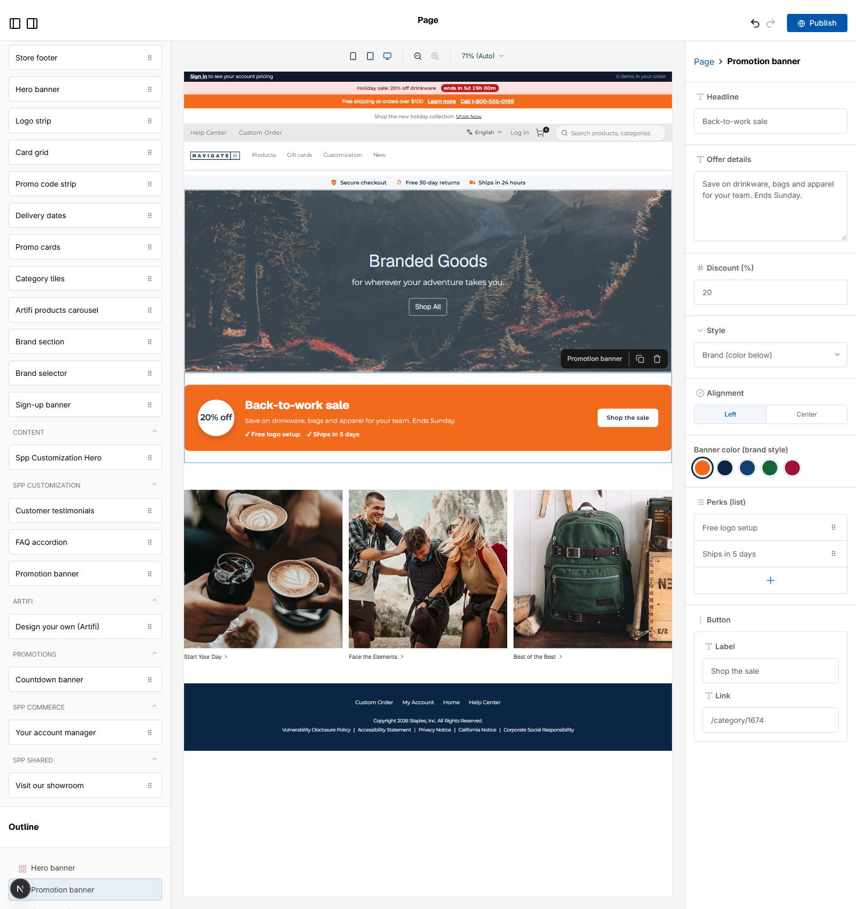

# 063: Are text, textarea, number, select, radio, list, object and custom fields supported?

**Listed:** Yes. **Result here:** Yes, all eight, in one widget.

Page builder for POCSppDemo, the Promotion banner (062) dragged onto the home page (not published), editor 1700 px
tall so the whole panel shows.

## The example: the Promotion banner, every field type

| Field | Type | On the banner |
| --- | --- | --- |
| Headline | `text` | "Back-to-work sale" |
| Offer details | `textarea` | the line under it |
| Discount (%) | `number` | the "20% off" badge |
| Style | `select` | Brand / Dark / Light |
| Alignment | `radio` | Left / Center |
| Banner color (brand style) | `custom` | **brand swatches** drawn by the theme: a free color picker would let a banner leave the brand palette; the swatches are radio buttons with names for screen readers |
| Perks (list) | `array` (list) | "✓ Free logo setup ✓ Ships in 5 days", rows added, removed and reordered in the panel |
| Button | `object` | Label + Link: the "Shop the sale" button |

## Where

- `src/widgets/PromoBanner.tsx`: `accent` (custom field: `render({ value, onChange, readOnly })` returning the
  `SwatchPicker`), `perks` (`type: "array"`, `arrayFields`, `getItemSummary`), `button` (`type: "object"`,
  `objectFields`); the component renders perks, the button and the chosen color (only brand colors are accepted)
- `src/styles/widgets.css`: perks, button and swatch styles

## How a client does this

Use Puck 0.17 field definitions in the widget's `fields`; a `custom` field brings its own editor UI through `render`.
