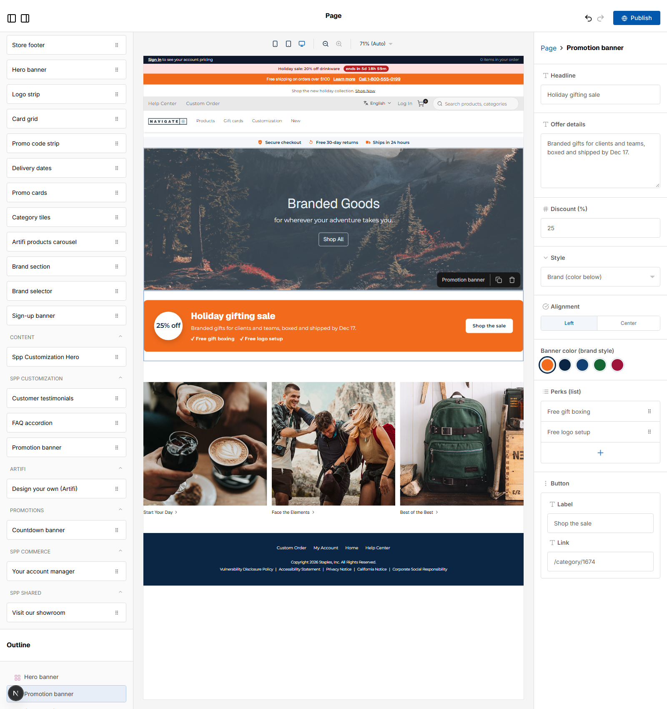

# 064: Can a widget have default values?

**Listed:** Yes. **Result here:** Yes, confirmed, including defaults worked out when the block is placed.

| Before: fixed defaults ("Back-to-work sale") | After: dropped in November ("Holiday gifting sale") |
| --- | --- |
|  |  |

Page builder for POCSppDemo, a new Promotion banner dragged onto the home page (not published).

## The example: season-aware defaults for new banners

A merchandiser dropping a new Promotion banner should start from the current campaign, not an off-season placeholder.
The banner's defaults now depend on when it is placed:

| Placed in | Starts with |
| --- | --- |
| November-December | "Holiday gifting sale", 25% off, perks "Free gift boxing", "Free logo setup", shipped-by-Dec-17 details |
| August-October | "Back-to-work sale", 20% off |
| May-July | "Summer event season", 15% off, rush production |
| January-April | "New year, new gear", 15% off, onboarding kits |

Every value is still a field the merchandiser can change; defaults only apply to a newly placed block (saved blocks
keep their values).

## Where

- `src/widgets/PromoBanner.tsx`: `seasonalDefaults(now)`; `PROMO_BANNER_EDITOR.defaultProps` is a getter, so the
  editor gets the season's values each time it asks

## How a client does this

Give the editor definition `defaultProps` (an object, or a getter when they should depend on the date, the store or
settings).
