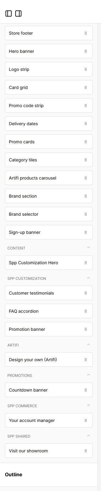
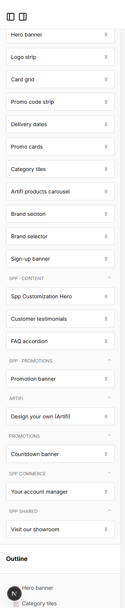

# 065: Can a widget appear in its own editor category?

**Listed:** Yes. **Result here:** Yes, confirmed.

| Before: one catch-all "Spp Customization" (+ the hero under "Content") | After: "SPP · Content" and "SPP · Promotions" |
| --- | --- |
|  |  |

Page builder for POCSppDemo, the component list.

## The example: categories the way merchandisers think

Each widget's editor definition names its category; the page builder groups the list by it. The theme's widgets are
regrouped by what a merchandiser is doing:

| Category | Widgets |
| --- | --- |
| **SPP · Content** | Spp Customization Hero, Customer testimonials, FAQ accordion |
| **SPP · Promotions** | Promotion banner |

The other packages keep theirs: "SPP commerce" (the plugin's account manager), "SPP shared" (the shared showroom
widget), "Artifi", "Promotions" (countdown banner).

## How it renders

**In the webstore (base):** the page builder ([§9 A](../../RENDER-FLOW.md#9-home-content-and-package-pages-widgets))

**How this customization joins it:** `category` decides the component-list group in `addRuntimeWidgets` ([§9 B.4](../../RENDER-FLOW.md#9-home-content-and-package-pages-widgets))

End-to-end flow, with file and line references in the webstore: [docs/RENDER-FLOW.md](../../RENDER-FLOW.md).

## Where

- `src/widgets/Hero.tsx`, `Testimonials.tsx`, `Faq.tsx`: `category: "SPP · Content"`
- `src/widgets/PromoBanner.tsx`: `category: "SPP · Promotions"`

## How a client does this

Set `category` in the widget's editor definition (default "Store widgets"). The order of the categories themselves
is the editor's (row 72).
