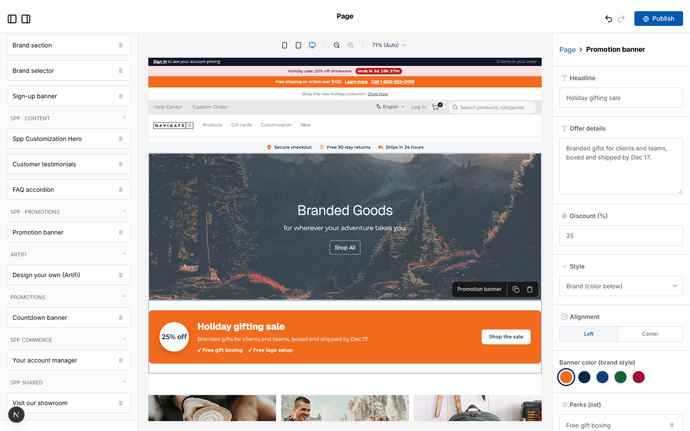
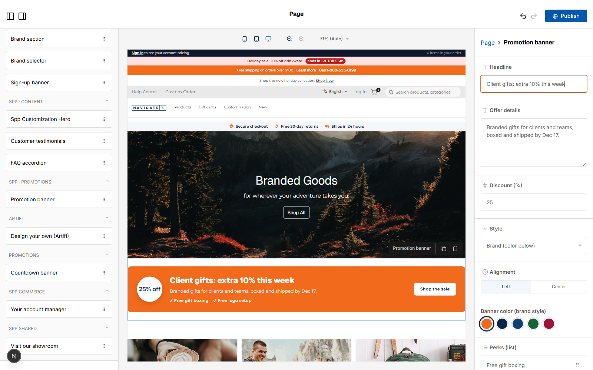

# 066: Does the editor preview a widget live while editing?

**Listed:** Yes. **Result here:** Yes, confirmed, as the merchandiser types.

| Before: the new banner with its defaults | After: headline typed in the panel, canvas already showing it |
| --- | --- |
|  |  |

Page builder for POCSppDemo; a Promotion banner dragged onto the home page, then "Client gifts: extra 10% this week"
typed into its **Headline** field by `scripts/editor.mjs` (the cursor is still in the field). Not published.

## The example: editing a promotion in place

The merchandiser changes the banner's headline: the canvas shows the new headline character by character, with the
theme's own styles (the badge, the perks, the button), before anything is saved or published. The canvas renders the
widget with the same component the store uses, so what is previewed is what shoppers will see.

## How it renders

**In the webstore (base):** the page builder ([§9 A](../../RENDER-FLOW.md#9-home-content-and-package-pages-widgets))

**How this customization joins it:** the editor previews a package widget with `RuntimeWidget`, the same component the store renders ([§9 B.2, B.4](../../RENDER-FLOW.md#9-home-content-and-package-pages-widgets))

End-to-end flow, with file and line references in the webstore: [docs/RENDER-FLOW.md](../../RENDER-FLOW.md).

## Where

No code change: the theme's widget (062-064) and the page builder. `scripts/editor.mjs --field <label> --type <text>`
types into a field of the selected widget before the screenshot.

## How a client does this

Nothing to add: any widget's fields preview live. Keep the widget's render free of `window` / `Date.now()` during
render so the editor and the store draw it the same way.
