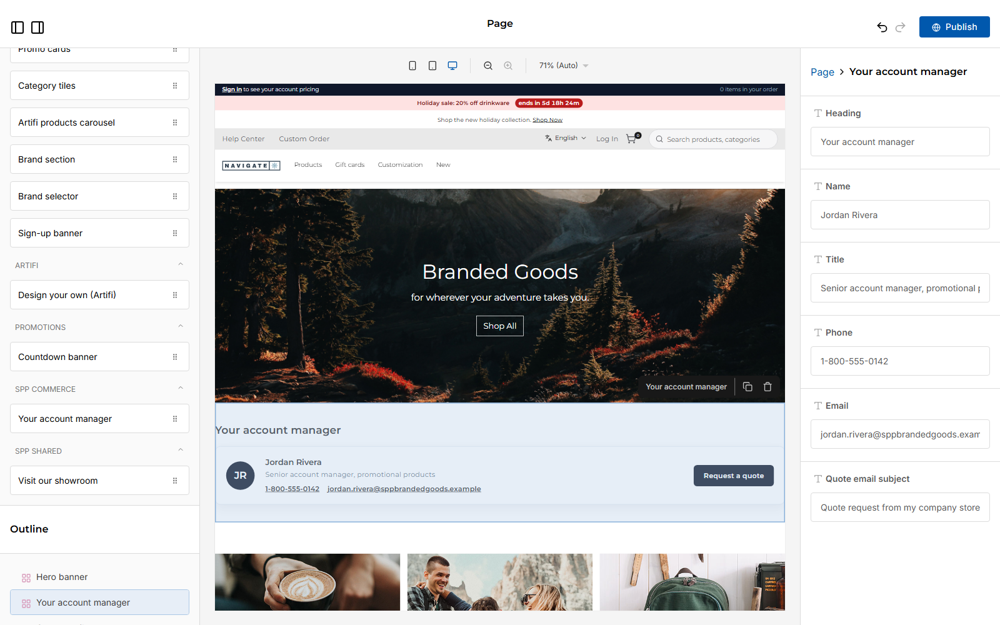
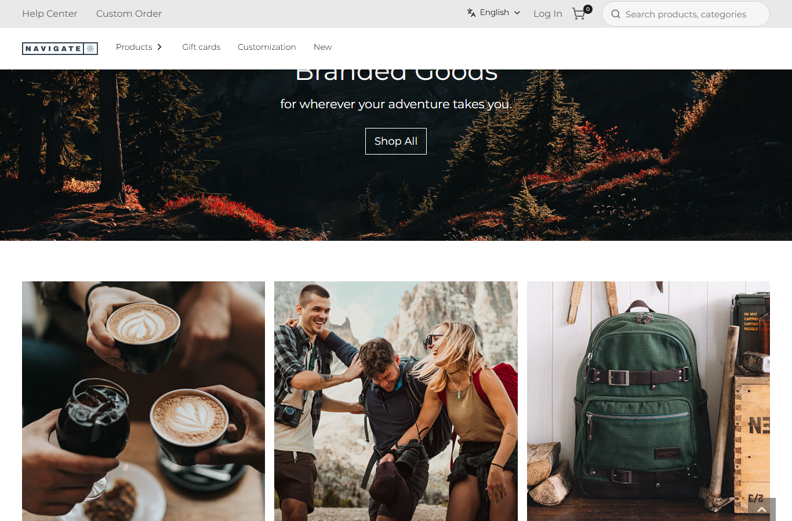
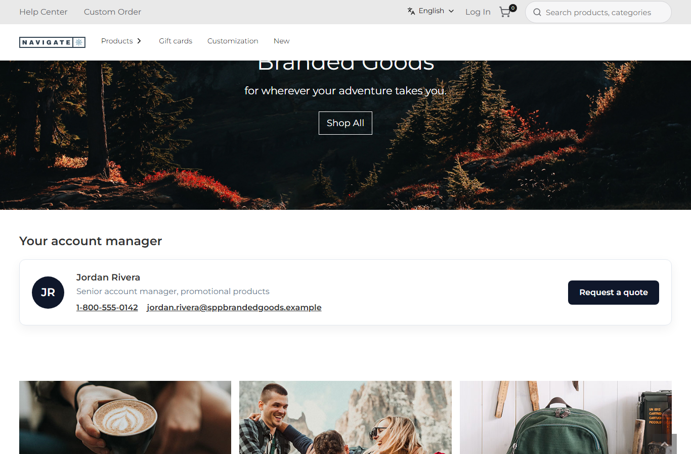

# 067: Can I drag a new package widget onto a page and publish it?

**Listed:** Not tested. **Result here:** Yes, with **local publishing only**: the page is published to this repo's
package and served from the local plugin folder; the shared Znode CMS is never written.

| 1. Dropped and "published" in the editor | 2. The store's home page before | 3. After the local publish |
| --- | --- | --- |
|  |  |  |

Proof the CMS was not touched, the editor reopened afterwards (it loads the page from the CMS: hero and tiles only):
[cms-unchanged.png](cms-unchanged.png).

## The example: add the account manager card to the home page, published locally

1. In the page builder for POCSppDemo, the **Your account manager** widget (spp-commerce plugin, 061) is dragged
   between the hero and the category tiles, and **Publish** is pressed.
2. The page builder has no local publish of its own: Publish always sends the page to Znode
   (`POST /en-US/page-builder`, a server action that calls the CMS API). `scripts/editor.mjs --publish-local` lets the
   editor's Publish run but **blocks every write request in the browser** and keeps the page JSON it tried to send:

   ```
   clicked: Publish
   blocked (not sent): POST /en-US/page-builder (1498 bytes)
   saved locally: src/commerce/pages/home.json (3 blocks: HeroBanner, SppAccountManager, CategoryTiles)
   ```

3. The saved JSON becomes the spp-commerce plugin's page for `/` (`"pages"`) and is deployed to the local plugin folder.
   The store renders a package's page content for that path (the last package that has one wins: spp-commerce comes
   after the Navigate content package), with the widget rendered by the plugin.

The real CMS publish stays available on purpose only: `scripts/editor.mjs --publish` refuses to run unless
`ALLOW_CMS_PUBLISH=yes` is set, since CMS content is shared.

## How it renders

**In the webstore (base):** the editor saves through `POST /en-US/page-builder` → the Znode visual-editor API (blocked
here); the storefront home is `[locale]/page.tsx` → `getPage({ url: "home" })` → `<PageRender>`
([§9 A](../../RENDER-FLOW.md#9-home-content-and-package-pages-widgets)).

**How this customization joins it:** `RuntimePageRender` → `getRuntimePage("/")` takes the spp-commerce package's
`home.json` (last package with that path) instead of the API's page, prepares its widgets like the API's, and
`RuntimeWidget` renders `SppAccountManager` from the plugin's browser bundle
([§9 B.1, B.2](../../RENDER-FLOW.md#9-home-content-and-package-pages-widgets)).

End-to-end flow, with file and line references in the webstore: [docs/RENDER-FLOW.md](../../RENDER-FLOW.md).

## Where

- `scripts/editor.mjs`: `--publish-local <file.json>` (Publish with every write blocked, page JSON saved), `--publish`
  guarded by `ALLOW_CMS_PUBLISH=yes`, works without `--widget` (just open and screenshot)
- `src/commerce/pages/home.json` (new): the locally published page
- `spp-commerce.znode-package.json`: `"pages": { "/": "src/commerce/pages/home.json" }`

## How a client does this

Edit in the page builder, publish locally (`node scripts/editor.mjs --store <code> --widget "<widget>"
--publish-local <package>/pages/<page>.json --out <png>`), add the page to the package's `"pages"`, `npm run deploy`.
To take it back, remove the page from `"pages"` and deploy: the store shows the CMS / content package page again.
