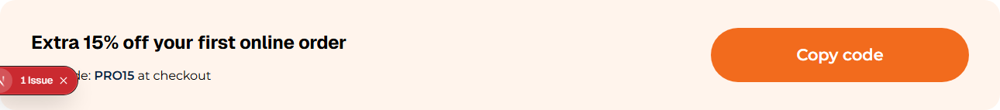
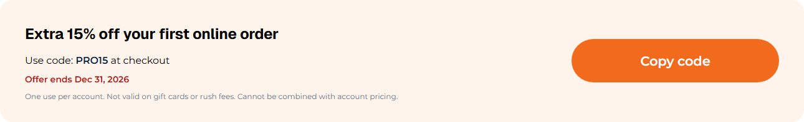

# 068: Can I update an existing widget's config (fields, defaults)?

**Listed:** Partial. **Result here:** Yes, with one rule (the reason for "Partial"): a package that changes a widget
type also renders it, because the original component is not reachable from a package. So the package keeps the
original's look by rendering the same markup, as here.

| Before | After |
| --- | --- |
|  |  |

In the editor, the original fields plus the two new ones: [editor.png](editor.png).

## The example: an expiry date and terms on the Promo code strip

The parent theme's **Promo code strip** (spp-base, "SPP widgets") shows a code and a Copy button. Real coupons need two
more things, so the theme adds two fields to that widget type:

- **Expires on** (`YYYY-MM-DD`): the strip shows "Offer ends Dec 31, 2026" in red, and **hides itself after that day**,
  so an expired code is never shown
- **Terms**: small print under the code

The page builder merges the fields: the strip's eight original fields (title, text, code, suffix, button text,
background, button color, code color) stay, the two new ones follow; defaults likewise. The strip keeps its category
and its look. Checked: with yesterday's date the strip is not rendered; with Dec 31 it shows with its end date
(`output.txt`).

## Where

- `src/widgets/PromoCodeStripPlus.tsx` (new): the strip (the parent's markup and classes, plus the end date and terms;
  copy-to-clipboard kept) and `PROMO_CODE_STRIP_EDITOR` (only the two added fields)
- `src/browser.tsx`: `widgets: { PromoCodeStrip: ... }` (the existing type's name)
- `znode-package.json`: `"widgets"` adds `PromoCodeStrip`
- `src/styles/widgets.css`: `.spp-customization-strip__ends`, `__terms`
- `src/pages/home.json`: the home page's strip gets `expiresOn: 2026-12-31` and terms
- `scripts/shot.mjs`, `scripts/editor.mjs`: hide the dev server's badge from screenshots

## How a client does this

Register a widget under the existing type's name with only the fields to add; render the type (reproduce its markup to
keep the look, or a new design: 070).
