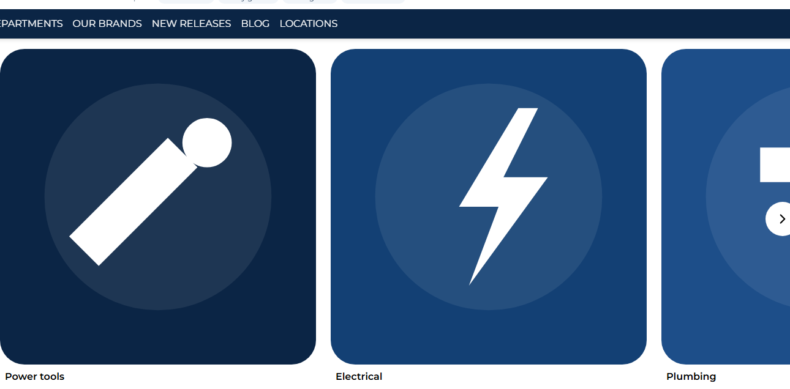
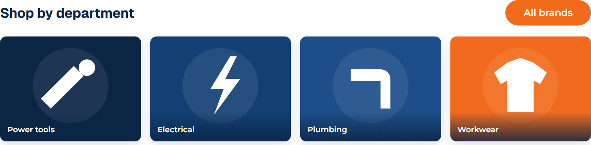

# 069: Can I change an existing widget's design?

**Listed:** Yes. **Result here:** Yes, confirmed, with CSS only (the widget's code, fields and content are untouched).

| Before | After | After, phone |
| --- | --- | --- |
|  |  |  |

The theme's home page on the Acme store (preview), the "Shop by department" block.

## The example: fixing and restyling the parent theme's Card grid

The **Card grid** widget (spp-base) is set to 4 columns here, but its card width comes from a class built at runtime,
`md:w-[calc((100%-72px)/4)]`, which is not in the store's compiled CSS. Every card fell back to 40% of the row: three
giant square tiles in a side scroller with arrows, the fourth department out of view.

The theme's stylesheet turns it into the department grid shoppers expect:

- a real grid: **4 columns** from 768 px, 2 on phones; all departments in view, the scroll arrows hidden
- 4:3 tiles with rounded corners and a soft shadow
- the department name **over** the tile on a navy gradient, instead of under it
- a visible focus outline for keyboard users

## Where

- `src/styles/card-grid.css` (new): rules on the widget's own class (`.card-grid-widget`) and hooks
  (`[data-test-selector^="divCard"]`), under `html[data-theme]`

## How a client does this

Restyle a widget through its root class and `data-test-selector` attributes in a theme stylesheet; the same widget
keeps its editor fields and saved content.
