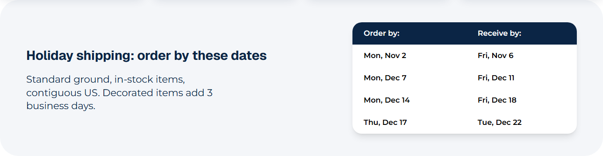
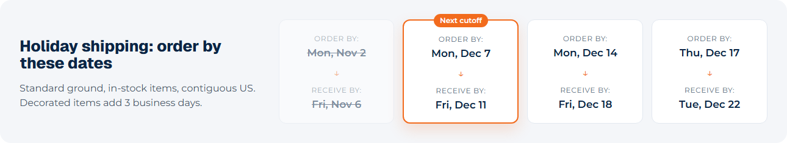

# 070: Can I replace how an existing widget renders?

**Listed:** Yes. **Result here:** Yes, confirmed: same widget type, same saved content, new rendering.

| Before: the parent theme's table | After: the theme's shipping timeline |
| --- | --- |
|  |  |

The theme's home page on the Acme store (preview), 10 Nov 2026.

## The example: delivery dates as a holiday shipping timeline

The parent theme's **Delivery dates** widget (spp-base) shows order-by / receive-by pairs as a table. The theme
renders the same widget type as the timeline holiday storefronts use:

- one card per cutoff: "Order by Mon, Dec 7 ↓ Receive by Fri, Dec 11"
- the **next upcoming cutoff** highlighted with a "Next cutoff" badge
- cutoffs that have **passed** dimmed and struck through (Nov 2 here), worked out from today's date

The widget's saved props are read as they are (heading, text, the two column labels, rows, text color), so every page
that already uses Delivery dates gets the new design with no content change; its editor fields stay the parent's (the
theme adds none).

## Where

- `src/widgets/DeliveryTimeline.tsx` (new): the rendering; `DELIVERY_TIMELINE_EDITOR` with no extra fields
- `src/browser.tsx`: `widgets: { DeliveryDates: ... }` (the existing type's name)
- `znode-package.json`: `"widgets"` adds `DeliveryDates`
- `src/styles/widgets.css`: `.spp-customization-timeline*`
- `src/pages/home.json`: the home page's delivery dates set to the holiday cutoffs (Nov 2 to Dec 17)

## How a client does this

Register a widget under the existing type's name with your own `render`; read the props the type already saves.
