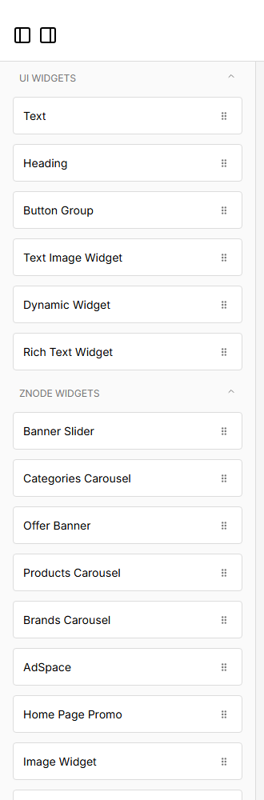
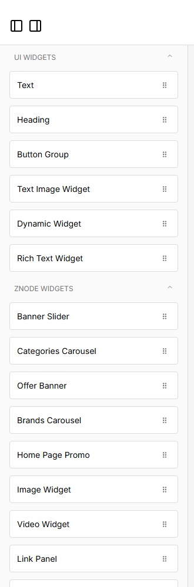

# 071: Can I hide or remove a base widget from the page builder for a theme?

**Listed:** No. **Result here:** Yes, **hide** from the list, per theme: the page builder loads the edited store's
theme stylesheets into the editor, so the theme's CSS can leave widgets out of the component list. **Removing** a
widget type (so it could not be used at all) still needs a page-builder change: pages that already contain a hidden
widget keep rendering it, and a saved page's JSON could still name it.

| Before | After |
| --- | --- |
|  |  |

Page builder for POCSppDemo (spp-customization live there for the widget rows), "Znode widgets" in the component list.

## The example: a curated widget list for the SPP stores

Merchandisers should not pick a block that does not work on their store. The theme hides three base widgets from the
list on its stores:

| Hidden | Why |
| --- | --- |
| Products Carousel | SPP stores take product images from Artifi: "Artifi products carousel" is the one to use |
| Newsletter Widget, AdSpace | not offered on the SPP company stores |

Stores on other themes see the full list (the stylesheet is only loaded where this theme runs).

## How it works

`RuntimePageEditor.tsx` (store repo) links the edited store's runtime stylesheets into the editor (`linkRuntimeStyles`).
Each list item carries a stable drag-and-drop id, `data-rfd-draggable-id="component-list:<category>::<WidgetType>"`
(listed for this store in `output.txt`); the theme's CSS hides the ones it leaves out. The selectors never match on the
storefront.

## How it renders

**In the webstore (base):** the page builder ([§9 A](../../RENDER-FLOW.md#9-home-content-and-package-pages-widgets))

**How this customization joins it:** `linkRuntimeStyles` links the theme's CSS into the editor; `src/styles/editor.css` hides list items by their drag-and-drop ids ([§9 B.4](../../RENDER-FLOW.md#9-home-content-and-package-pages-widgets))

End-to-end flow, with file and line references in the webstore: [docs/RENDER-FLOW.md](../../RENDER-FLOW.md).

## Where

- `src/styles/editor.css` (new): `[data-rfd-draggable-id$="::ProductsCarousel"]`, `…::NewsLetter`, `…::AdSpace`
  hidden

## How a client does this

Find the widget's type in the editor (its `data-rfd-draggable-id`), hide it in a theme stylesheet.
