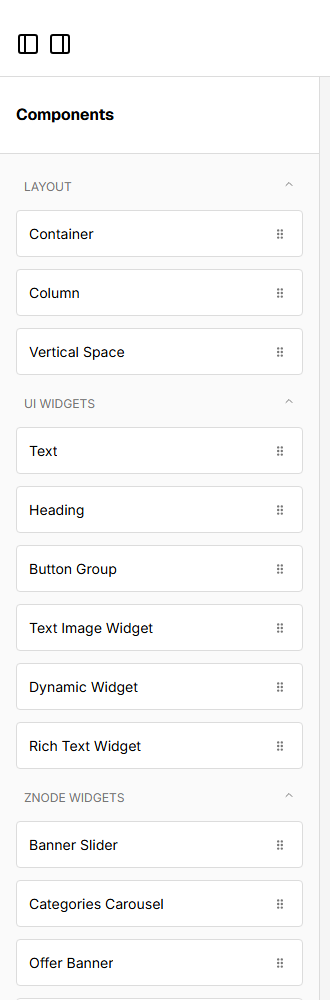
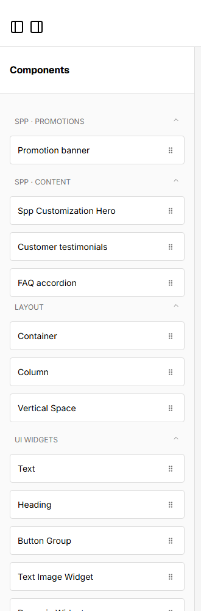

# 072: Can I reorder the editor's widget categories?

**Listed:** No. **Result here:** Yes, visually, per theme (the same way as 071: the theme's stylesheet in the editor).
Keyboard order still follows the editor's own order; reordering the categories in the editor's config itself would be
a page-builder change.

| Before | After |
| --- | --- |
|  |  |

Page builder for POCSppDemo, top of the component list.

## The example: the theme's categories first

Merchandisers on the SPP stores mostly use the theme's own blocks, so its categories lead the list:

1. **SPP · Promotions** (Promotion banner)
2. **SPP · Content** (Spp Customization Hero, Customer testimonials, FAQ accordion)
3. then the editor's order: Layout, UI widgets, Znode widgets, SPP widgets, …

## How it works

Each category is a component list containing a drop zone with a stable id,
`data-rfd-droppable-id="component-list:<category>"`. The theme makes their column a flex column and gives its two
categories a negative `order`. Class names are matched by their stable prefix (`[class*="_ComponentList_"]`), since the
suffix is a build hash.

## How it renders

**In the webstore (base):** the page builder ([§9 A](../../RENDER-FLOW.md#9-home-content-and-package-pages-widgets))

**How this customization joins it:** as 071: `linkRuntimeStyles`, then CSS `order` on the categories ([§9 B.4](../../RENDER-FLOW.md#9-home-content-and-package-pages-widgets))

End-to-end flow, with file and line references in the webstore: [docs/RENDER-FLOW.md](../../RENDER-FLOW.md).

## Where

- `src/styles/editor.css`: the category order rules (with 071's curated list)

## How a client does this

In a theme stylesheet, `order` the category containers by their drop-zone id.
